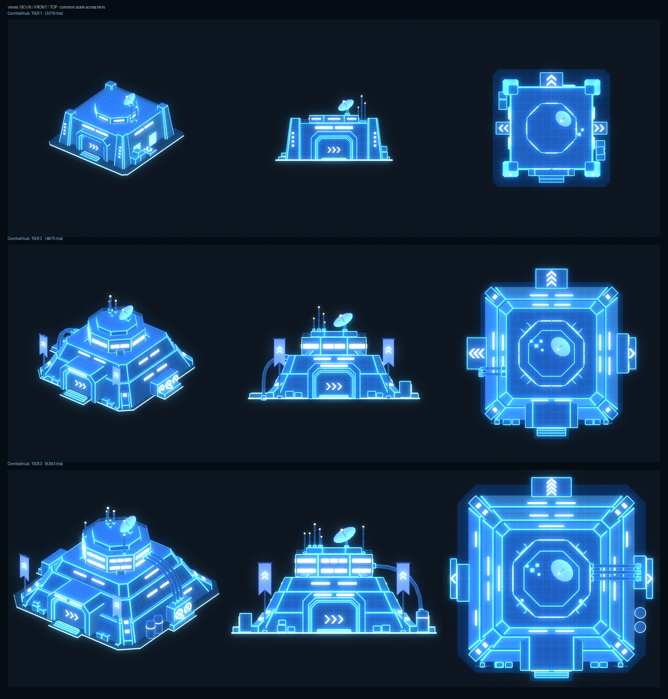
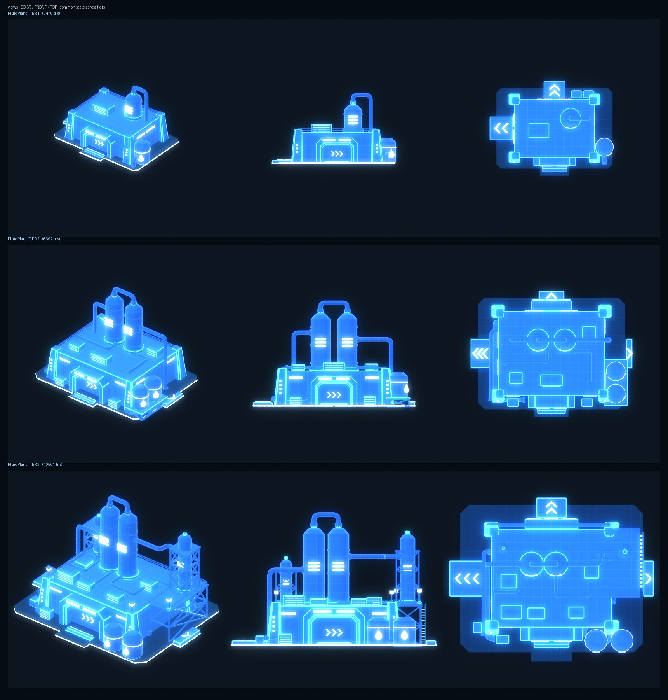
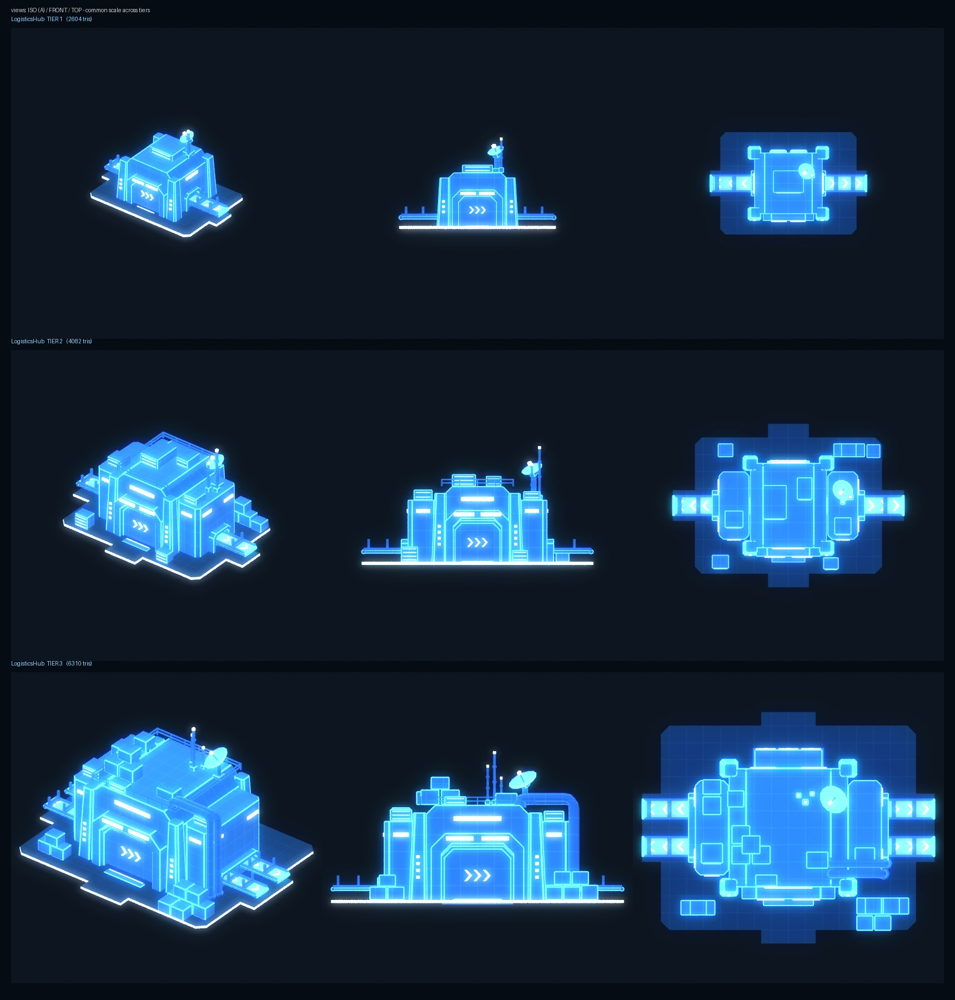
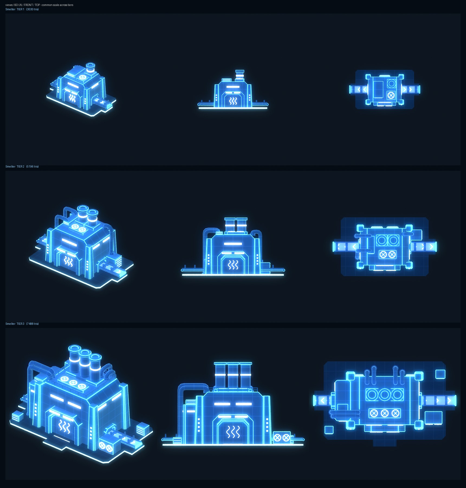
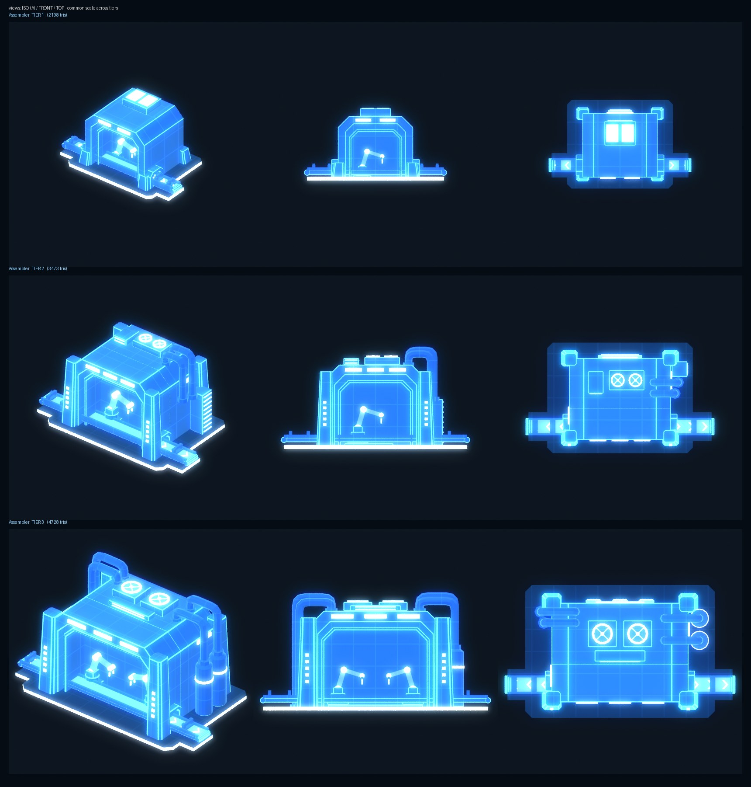
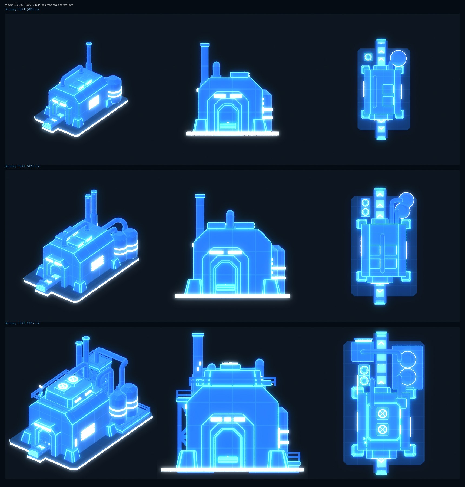
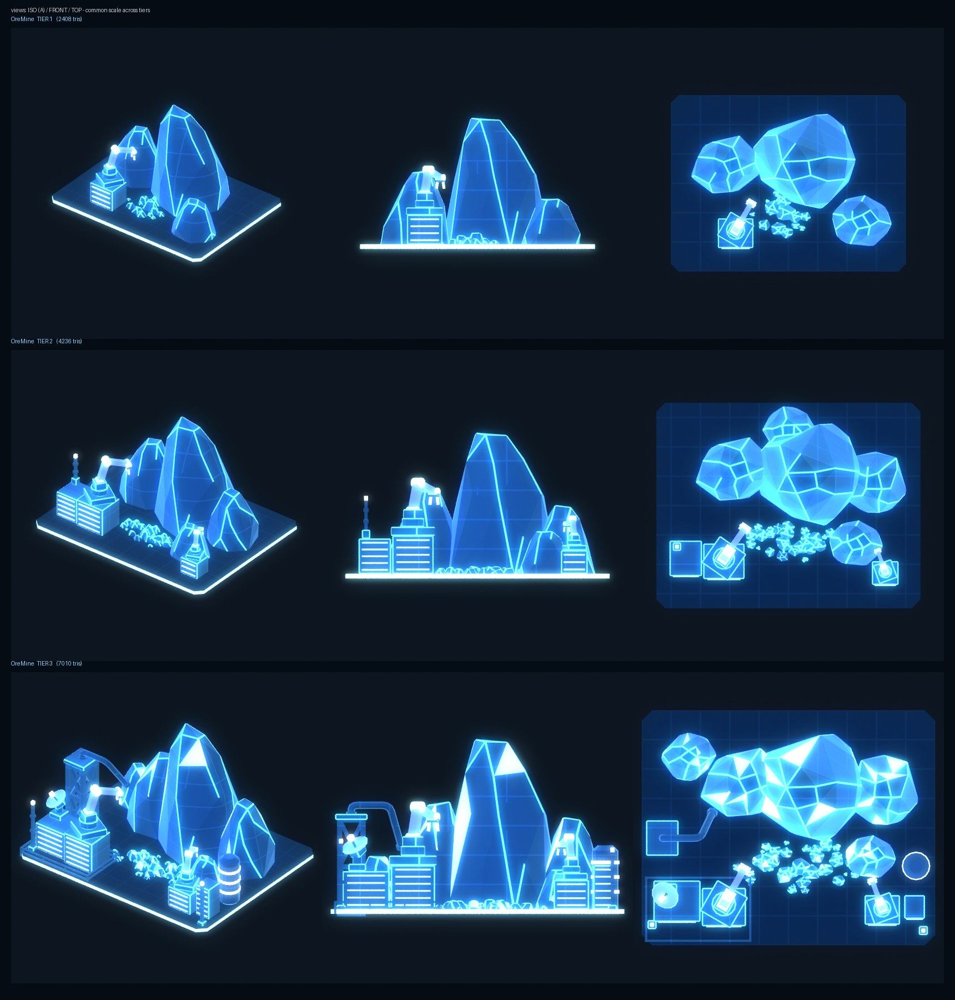

# Узлы базы — голограммы для проектора и рендеры для экранов терминала

Узел базы показывается в трёх видах. Все три собираются из одной спецификации, [`nodes.json`](nodes.json):

| Где | Что | Файлы |
|---|---|---|
| Проектор командного центра, **один узел** | 3D-голограмма, вписана в объём проектора | `export/SM_Holo_<Node>_T<n>.fbx` |
| Проектор, **2–5 узлов** | облегчённые голограммы в общем масштабе | `export/SM_Holo_<Node>_T<n>_Mini.fbx` |
| Экраны терминала | заготовленный рендер с 3D-модели (изометрия, прозрачный фон) | `ue/screens/T_Node_<Node>_T<n>_Screen.png` (1280 × 800, + `_640`) |
| Списки / карта в UI | иконка с концепт-арта | `icons/T_Node_<Node>_T<n>_Icon_{512,256,128,64}.png` |

Готовые узлы (уровни 1–3, концепты в [`reference/`](reference/)):
- **Центральный хаб** (`central_hub`) — управление / координация;
- **Завод переработки жидкостей** (`fluid_plant`) — переработка / химические процессы;
- **Узел логистики** (`logistics_hub`) — логистика / распределение;
- **Узел плавки** (`smelter`) — переработка / плавка;
- **Узел сборки** (`assembler`) — производство / сборка;
- **Узел переработки** (`refinery`) — переработка (на концепте тип подписан «Переработка / плавка», как у узла плавки);
- **Узел добычи руды** (`ore_mine`) — добыча ресурсов.
Анимации смены уровня нет: уровень — это отдельный меш, смена — простая замена меша.









## 1. Как устроено: модульный набор + сборка скриптом

Узел описывается списком модулей (`nodes.json → nodes.<id>.tiers.<n>.modules`), а `blender/build_nodes.py`
собирает его в один меш. Типы модулей (код — [`blender/bn_kit.py`](blender/bn_kit.py)):

| Модуль | Что это | Хаб |
|---|---|---|
| `plate` | плита-основание: квадрат или крест, светящийся контур, внутренняя часть затемнена | все уровни |
| `mass` | наклонный ярус (усечённая пирамида), `strips` — световые окна на гранях | T1: 1 ярус, T2: 2, T3: 3 |
| `pylons` / `buttresses` | угловые пилоны (T1) / диагональные контрфорсы до башни с огнями | T1 / T2–T3 |
| `gate` | портал: внешняя и внутренняя рамы, панель с `>>>`, световые полосы, ступени | все |
| `arm` | низкие крылья плиты с шевронами наружу | все |
| `tower` | восьмигранная башня с поясами окон (+ корона) | T1 — низкий восьмигранник на крыше, T2–T3 — башня |
| `dish`, `antennas`, `banner` | тарелка, мачты с огнями, флаги с шевронами | все / T2–T3 |
| `fans`, `tanks`, `pipes`, `shutter`, `crates`, `railing` | вентиляторный блок, баки (`glyph: drop` — светящаяся капля), трубы, ворота, ящики, ограждения | по уровню |
| `columns` | технологические колонны: юбка, кольца, светящиеся щели, купол, патрубок | завод жидкостей |
| `lattice`, `stairs`, `lamps`, `units` | стальная ферма с X-связями (+ настил), лестница, мачты освещения, блоки с жалюзи | завод жидкостей |
| `pipes.runs` | трубопровод по ломаной со скруглёнными углами (U-петли над колоннами, обвязка по стенам и крыше) | завод жидкостей, логистика T3 |
| `profile` | корпус-«зал»: контур в плоскости (x, z) со срезанными углами крыши, вытянутый по Y; световые полосы на гранях | узел логистики |
| `stacks`, `roof_fans` | дымовые трубы с широким оголовком и светящимся поясом; короб вентиляторов на крыше (вентиляторы вверх) | узел плавки |
| `rocks`, `rubble` | гранёные скалы (выпуклая оболочка колец со случайным смещением, `seed` — повторяемо; рёбра граней от 12° светятся, как кристалл на концепте; `veins` — доля светящихся рудных граней) и россыпь щебня (в `_Mini` реже и крупнее) | узел добычи руды |
| `stacks.slim` | тонкая ступенчатая труба с поясом и оголовком | узел переработки |
| `tanks.bands` | несколько светящихся поясов на баке | узел переработки |
| `profile.axis: "x"` | корпус, вытянутый вдоль X (срезанные углы на торцах) | узел переработки |
| уровень `yaw` | поворот всего узла после сборки (модель собирается удобно, потом разворачивается входом вперёд) | узел переработки (90°) |
| `robots` | сборочный робот-манипулятор на пьедестале: суставы светятся, двухпалый захват; `[x, y, z0, масштаб, поворот]` | узел сборки |
| `gate.chevrons.kind` | знак узла на портале: `target` (хаб), `drop` (завод жидкостей), `swap` (логистика), `heat` (плавка) | 4 узла |
| `gate.u` | сдвиг портала вдоль грани (боковой проём напротив смещённой ленты) | узел сборки |
| `gate.chevrons.kind: "heat"` | вместо `>>>` — три светящиеся волны жара (дверца печи) | узел плавки |
| `conveyor` | ленточный конвейер на опорах: станина, борта, ролики, опоры парами, светящиеся шевроны **от здания наружу**; `hidden` — участок внутри корпуса | узел логистики |

Плита (`plate`) — квадратный крест (`core`, `arm`, `reach`) или прямоугольник `core: [hx, hy]` с крыльями по сторонам
(`arms: {front: [полуширина, вылет], ...}`; у левого и правого крыла третье число — сдвиг по Y, под смещённую ленту).

**Постоянные приметы узла на всех уровнях:** портал с `>>>` и ступенями, восьмигранник на крыше, тарелка (смотрит вперёд-влево),
группа антенн, светящийся контур плиты. Уровень 1 по сравнению с концептом подтянут к ряду T2–T3: вместо
квадратного короба на крыше стоит низкий восьмигранник с поясом света, чтобы повышение уровня читалось как «достроили».

**Завод переработки жидкостей** — тот же семейный язык (портал с `>>>` и ступенями, угловые пилоны, световые полосы,
контур плиты), но корпус прямой, без ярусов. Его собственные приметы: технологические колонны со щелями и U-петлями труб,
баки с каплей, обвязка трубами. T1 — корпус, одна колонна и один бак. T2 — две колонны с перемычкой, два бака на
площадке-ферме, блок с тремя вентиляторами сзади. T3 — две большие колонны, стальная пристройка с настилом, лестницей и
колонной в ферме, ферма с колонной слева, мачты освещения, трубопроводы по крыше и стенам.

**Узел логистики** — корпус-туннель над сквозным конвейером: лента на опорах проходит через здание по оси X и выходит
в обе стороны через боковые проёмы-рамки, шевроны на ленте смотрят наружу. Спереди семейный портал с `>>>`, угловые пилоны
с огнями, тарелка и антенна. T1 — один зал и одна лента. T2 — зал с двумя боковыми блоками, рулонные ворота сзади,
штабели ящиков. T3 — две ленты, вентиляторный блок сзади, склад ящиков на крыше под кран-балкой (самый высокий элемент — T3 читается
по силуэту), трубы по правому боку. На концептах виды
расходятся (на изометрии лента идёт через портал вперёд, на чертежах — по бокам), за основу взяты чертежи (вид сверху и спереди).

**Узел плавки** — тот же корпус-зал со сквозным конвейером, что у логистики, но спереди дверца печи с волнами жара
вместо `>>>`, на крыше дымовые трубы (T1 — одна, T2 — две, T3 — три) и короба вентиляторов. T2 — трубы по стенам,
T3 — пристройка слева с проёмом для ленты, вентиляторный блок на земле справа, четыре стояка труб сзади, ограждение крыши.

**Узел сборки** — зал со срезанными углами, но фасад — большое смотровое окно на всю ширину: рама-портал
с внутренней рамкой, за ней неглубокий отсек, где по ленте (смещена вперёд, к окну) работают роботы-манипуляторы,
развёрнутые вдоль окна, чтобы читаться спереди. T1 — открытая арка, один робот, короб с двумя жалюзи на крыше. T2 — робот
на подиуме, короб с двумя вентиляторами на крыше, трубы и высокий шкаф справа, ворота сзади. T3 — два робота навстречу
друг другу, два вентилятора на крыше, трубы слева и справа, два бака справа, жалюзи и световые полосы сзади.

**Узел переработки** — корпус вытянут вдоль ленты, вход на торце со срезанными углами и сигнальными
огнями, на длинной грани — светящаяся решётка, сбоку баки с поясами и тонкие ступенчатые трубы, через крышу — U-трубы.
Собран с лентой по X и развёрнут на 90° (`yaw`), чтобы вход смотрел вперёд, как на виде А концепта. T1 — один бак, одна
труба. T2 — два бака, две трубы, четыре жалюзи на крыше. T3 — надстройка с двумя вентиляторами и ограждением
крыши, баки на площадке с ограждением, стальная башня с площадкой и лестницей, высокие трубы, трубопроводы.

**Узел добычи руды** — первый узел без корпуса: гранёный скальный массив, перед ним россыпь руды, добывающие машины
(корпус с жалюзи + манипулятор, тянущийся к скале). T1 — три скалы, одна машина. T2 — пять скал, блок управления с
антенной, вторая малая машина справа. T3 — светящиеся рудные грани на скалах и в щебне, копёр-ферма слева с трубой
к скале, тарелка, ограждённая площадка у машин, бак с поясами, мачты.

**Новый узел** = новая запись в `nodes.json` (модули из того же набора) + концепт в `reference/` для иконки.
Новый тип детали добавляется функцией в `bn_kit.py` и строкой в `BUILDERS`.

### Как голограмма выглядит без текстур

В мешах нет UV-текстур. Всё задают цвета вершин и один мастер-материал:

| Канал цвета вершин | Значение | Откуда |
|---|---|---|
| **R** — ребро | 1 на фасках твёрдых рёбер (угол > 35°) → яркие линии по контуру форм | фаска `bmesh.bevel`, ширина задана **в мм на голограмме** (`display.rim_mm` = 6) и пересчитана в метры модели по масштабу показа |
| **G** — свечение | окна, шевроны, контур плиты, кольца вентиляторов, огни мачт | детали-«светильники» |
| **B** — приглушение | 1 на внутренней части плиты: она тёмная, читается только контур | плита |

Материал (`MM_HoloSolid`, превью — `blender/bn_render.py`) неосвещённый. Его свечение складывается из трёх слагаемых:
- **заливка корпуса**, тёмно-синяя: ложный свет по нормали (верх светлее) плюс сетка панелей 2 м в координатах объекта;
- **рёбра и края по Френелю**, голубые;
- **светящиеся детали**, почти белые.

Поверх идут медленные сканлинии. Голограмма непрозрачная, поэтому проблем с сортировкой нет.

| Меш | Треугольники | Масштаб «один узел» | Фаска, м модели |
|---|---|---|---|
| `SM_Holo_CentralHub_T1` / `_Mini` | 3 319 / 1 869 | 0,0527 (1 : 19) | 0,114 / 0,564 |
| `SM_Holo_CentralHub_T2` / `_Mini` | 4 670 / 3 214 | 0,0454 (1 : 22) | 0,132 / 0,564 |
| `SM_Holo_CentralHub_T3` / `_Mini` | 6 393 / 4 677 | 0,0347 (1 : 29) | 0,173 / 0,564 |
| `SM_Holo_FluidPlant_T1` / `_Mini` | 3 440 / 2 298 | 0,0625 (1 : 16) | 0,096 / 0,564 |
| `SM_Holo_FluidPlant_T2` / `_Mini` | 6 692 / 4 882 | 0,0417 (1 : 24) | 0,144 / 0,564 |
| `SM_Holo_FluidPlant_T3` / `_Mini` | 10 561 / 7 410 | 0,0328 (1 : 30) | 0,183 / 0,564 |
| `SM_Holo_LogisticsHub_T1` / `_Mini` | 2 604 / 1 732 | 0,0952 (1 : 10,5) | 0,063 / 0,564 |
| `SM_Holo_LogisticsHub_T2` / `_Mini` | 4 082 / 2 554 | 0,0719 (1 : 14) | 0,083 / 0,564 |
| `SM_Holo_LogisticsHub_T3` / `_Mini` | 6 310 / 4 241 | 0,0538 (1 : 19) | 0,111 / 0,564 |
| `SM_Holo_Smelter_T1` / `_Mini` | 3 030 / 2 048 | 0,125 (1 : 8) | 0,048 / 0,564 |
| `SM_Holo_Smelter_T2` / `_Mini` | 5 196 / 3 885 | 0,0833 (1 : 12) | 0,072 / 0,564 |
| `SM_Holo_Smelter_T3` / `_Mini` | 7 488 / 5 585 | 0,0585 (1 : 17) | 0,103 / 0,564 |
| `SM_Holo_Assembler_T1` / `_Mini` | 2 198 / 1 302 | 0,145 (1 : 7) | 0,041 / 0,564 |
| `SM_Holo_Assembler_T2` / `_Mini` | 3 473 / 2 487 | 0,108 (1 : 9) | 0,055 / 0,564 |
| `SM_Holo_Assembler_T3` / `_Mini` | 4 728 / 3 549 | 0,0901 (1 : 11) | 0,067 / 0,564 |
| `SM_Holo_Refinery_T1` / `_Mini` | 2 958 / 2 076 | 0,125 (1 : 8) | 0,048 / 0,564 |
| `SM_Holo_Refinery_T2` / `_Mini` | 4 316 / 3 212 | 0,111 (1 : 9) | 0,054 / 0,564 |
| `SM_Holo_Refinery_T3` / `_Mini` | 6 592 / 5 135 | 0,0833 (1 : 12) | 0,072 / 0,564 |
| `SM_Holo_OreMine_T1` / `_Mini` | 2 512 / 1 116 | 0,103 (1 : 10) | 0,058 / 0,564 |
| `SM_Holo_OreMine_T2` / `_Mini` | 4 478 / 2 125 | 0,0906 (1 : 11) | 0,066 / 0,564 |
| `SM_Holo_OreMine_T3` / `_Mini` | 7 230 / 3 534 | 0,0808 (1 : 12) | 0,074 / 0,564 |

`_Mini` — без ограждений, ящиков, труб и планок ворот, мачты вдвое толще, фаски под мелкий масштаб.
Пять узлов на проекторе — не больше ≈ 28 тыс. треугольников (пять самых тяжёлых `_Mini`).

## 2. Проектор: один узел и до пяти

Объём взят из модели командного центра (`art/command_center/blender/interior_model.py`). Отсчёт идёт от `SOCKET_holo`:
низ голограммы на −0,93 м (верх диска эмиттера), радиус 1,0 м (внутри шкалы r 1,17), высота ≤ 1,0 м.

- **Один узел** — меш уровня вписан в объём; у каждого уровня свой масштаб (`ScaleSingle` в таблице). Голограмма T1 занимает
  платформу так же, как T3. Размеры показывает UI.
- **2–5 узлов** — `_Mini`-меши в **одном общем масштабе на раскладку**: самая большая плита из всех узлов и уровней заполняет
  слот (`slot_radius × margin`), поэтому T3 рядом с T1 честно больше. Раскладки (`display.multi.layouts`): 2 — рядом,
  3 — треугольник, 4 — квадрат, 5 — центр + 4 вокруг (слот 0 в центре — для хаба).

| Узлов | Радиус слота | Масштаб | T3 / T1 на проекторе, радиус |
|---|---|---|---|
| 2 | 0,50 м | 0,0160 | 0,46 / 0,30 м |
| 3 | 0,46 м | 0,0148 | 0,43 / 0,28 м |
| 4 | 0,41 м | 0,0132 | 0,38 / 0,25 м |
| 5 | 0,33 м | 0,0106 | 0,31 / 0,20 м |

Макеты с точки зрения игрока у пульта: `renders/review_projector_single_<node>_T1/T3.jpg` и
[`review_projector_multi5.jpg`](renders/review_projector_multi5.jpg) (в центре хаб T3, вокруг — T3 остальных узлов и T2 завода).
Облёт с разных ракурсов — [`renders/turnaround/`](renders/turnaround/): на каждый уровень 8 видов по кругу через 45°,
два низких, высокий и вид сверху; проектор — каждый узел T2 и пять узлов с четырёх точек (оператор, слева, сзади, вблизи).

## 3. Экраны и иконки

- **Рендер для экранов** — `ue/screens/T_Node_<Node>_T<n>_Screen.png`: изометрия «вид А» (спереди-справа сверху,
  как на концепте), ортокамера вписана в модель, прозрачный фон, свечение добавлено в альфу. Картинка ложится на любой тёмный
  фон виджета. Перерендер: `build_nodes.py --screens ../ue/screens`.
- **Иконка** — перерисована в векторе по панели «2D иконка» концепта: `tools/icons_svg.py` строит каждую иконку из
  примитивов на сетке 100 × 100 (порталы, шевроны, колонны, баки с каплей, трубы, роботы, скалы, кирка); общие детали
  у уровней одного узла, одна толщина линий (4,5 / 3), одна маска цвета на градиенте концепта + мягкое свечение.
  Исходники — `icons/svg/T_Node_<Node>_T<n>_Icon.svg`, PNG 512 / 256 / 128 / 64 растеризует Chromium из Playwright
  (чёткие на любом размере). `icons/_compare.png` — концепт и новая иконка рядом, `icons/_preview.png` — 128 и 64 px.
  Рамка и полоска уровня под иконкой — состояние UI, их рисует виджет. `tools/make_icons.py` (вырезание пиктограммы
  из концепта) остался только для листа сравнения.
- Текста в текстурах нет. Название и тип («Central Hub» / «Центральный хаб», «Fluid Processing Plant» / «Завод переработки жидкостей», «Logistics Node» / «Узел логистики», «Smelting Node» / «Узел плавки», «Assembly Node» / «Узел сборки», «Refining Node» / «Узел переработки», «Ore Mining Node» / «Узел добычи руды», …) хранятся в
  таблице как `FText` (`NSLOCTEXT("FicsitAIHelper.BaseNodes", "<node>.name" / "<node>.type", …)`). Русские строки —
  в `nodes.json → display_name / type_label → ru`, в `.po` их вносят так же, как тексты командного центра (`art/command_center/ue/README_UE.md` §6).

## 3а. Связи между узлами

**Одна линия на связь**, сколько бы ресурсов по ней ни шло: подпись перечисляет ресурсы, темп — сумма. Показываем
**направление и темп**, без статусов. Эталон алгоритма — [`blender/bn_links.py`](blender/bn_links.py), в UE его
повторяет `UFAIHHoloNodeDisplayComponent::SetLinks`; параметры — `nodes.json → display.links`.

| | Как |
|---|---|
| вид | светящаяся лента на полу голограммы (над плитами на 4 мм), по ней бегут шевроны `>` от узла-источника к получателю, по краям тонкие «рельсы» |
| темп | ширина ленты 18–48 мм и скорость бега 30–110 мм/с растут с логарифмом темпа (15 … 1200 шт/мин) |
| начало и конец | край плиты узла со стороны партнёра (контур плиты — `PlateOutline` в таблице, считается автоматически, вручную ничего не задаётся) |
| маршрут, 2–5 узлов | плавная кривая; если на пути стоит другой узел, лента огибает его; встречная пара A→B и B→A идёт двумя полосами, каждая по своей правой стороне |
| один узел | короткие отрезки от плиты до края платформы (r 1,24 м, за шкалой): входящие слева, исходящие справа, разведены на ±45° |
| подпись | виджет UI в точке `GetLinkLabelLocation(i)`: середина ленты (у встречной пары — на трети своей полосы), конец отрезка в режиме «один узел». На проекторе подписи — только у связей выбранного узла; полная подписанная схема — на экране терминала |
| экран терминала | та же схема в 2D: карточки узлов (заготовленные рендеры) на местах слотов проектора, ленты с шевронами и подписи |

Макеты: [`renders/review_links_multi5_top.jpg`](renders/review_links_multi5_top.jpg),
[`review_links_multi5_operator.jpg`](renders/review_links_multi5_operator.jpg),
[`review_links_single.jpg`](renders/review_links_single.jpg), экран — [`review_links_screen.jpg`](renders/review_links_screen.jpg).
Связи в макетах — примерные (`nodes.json → demo_links`), не данные игры.

UE: меш `SM_Holo_Link` (полоса 1 × 1 м вдоль +X, 8 сегментов) изгибается по кривой отрезками `USplineMeshComponent`;
материал `MM_HoloLink` (неосвещённый, аддитивный) берёт начало отрезка, его длину и скорость из custom primitive data,
поэтому штрихи бегут непрерывно по всей ленте. **Нужно в командном центре:** пока показаны узлы, приглушать светящийся
диск эмиттера (`emitter_dim` = 0,2), иначе ленты на нём тонут — правка `AFAIHCommandCenter`, отложена вместе с ним.
Проверить в редакторе: ось масштаба сечения у `USplineMeshComponent` (`SetStartScale.X` → ширина по Y меша).

## 4. UE

| Файл | Что |
|---|---|
| [`ue/ue_import_base_nodes.py`](ue/ue_import_base_nodes.py) | `--import`: строит мастер `MM_HoloSolid` (один Custom-узел HLSL + параметры) и `MI_HoloSolid`; импортирует меши (цвет вершин Replace, без Nanite и коллизии, MI на слот 0), рендеры экранов (группа UI, BC7, без мипов) и иконки (группа UI, без сжатия, без мипов). `--table`: `DT_BaseNodes` из `ue/base_nodes_table.json`. `--verify`: что есть / чего нет |
| `ue/base_nodes_table.json` | строки таблицы (пишет сборка): `central_hub_T1..T3`, `fluid_plant_T1..T3`, `logistics_hub_T1..T3`, `smelter_T1..T3`, `assembler_T1..T3`, `refinery_T1..T3`, `ore_mine_T1..T3` → пути к мешам и текстурам, `PlateRadius`, `Height` (см), `ScaleSingle` |
| `ue/Source/FicsitAIHelper/Public/Holo/FAIHBaseNodeTypes.h` | `FFAIHBaseNodeVisual` (строка таблицы), `FFAIHBaseNodeRef`, `FFAIHHoloLayout` |
| `ue/Source/.../Holo/FAIHHoloNodeDisplayComponent.{h,cpp}` | компонент проектора: `ShowSingle(NodeId, Tier)`, `ShowMulti([...до 5])`, `SetLinks([...])` / `ClearLinks()` / `GetLinkLabelLocation(i)`, `Clear()`, `SetPowered()`, `GetVisual()` для UI; до 5 дочерних мешей, MID на слот (`Intensity` для приглушённых узлов) |

Типы игры в этом коде не используются, поэтому он лежит вне `GameFacade/`. Проверка ADR-021 (`tools/ci/check_adr021.py`)
по всем `Source/`: 6 файлов, 0 нарушений.

Порядок в редакторе:
1. Скопировать `ue/Source/...` в модуль мода и собрать.
2. Выполнить `py ".../ue_import_base_nodes.py" --import`, затем `--table`.
3. У командного центра добавить `UFAIHHoloNodeDisplayComponent` на `SOCKET_holo` и задать `NodeTable = DT_BaseNodes`. Центральную
   «кристальную» часть `SM_CommandCenter_HoloSpin` при показе узлов скрыть. Это правка `AFAIHCommandCenter`, отложена
   вместе с командным центром.

**Проверено без редактора:**
- `art/command_center/ue/tools/ue_stub_dryrun.py --script ue/ue_import_base_nodes.py --modes=--import,--table,--verify --compiled-modes=--table`
  на стабе UE 5.6.0: все режимы без падений, 19 вызовов API, **0 расхождений**. Без собранного C++ остаётся один ручной шаг:
  «сначала скомпилировать модуль».
- **В настоящем редакторе не запускалось.** Там нужно проверить: компиляцию HLSL Custom-узла (вход `VertexColor`, векторные
  параметры через `.rgb`), чтение `NSLOCTEXT` при импорте `FText` из JSON и вид голограммы при игровой экспозиции и bloom
  (параметры `FillColor`, `EdgeColor`, `GlowColor`, `Intensity` в `MI_HoloSolid`).

## 5. Аудит и оптимизация

`blender/audit_nodes.py` проходит по всем мешам и печатает: треугольники, цену каждого модуля, невидимые грани
(смотрят вниз на уровне земли), совпадающие грани в одной плоскости (мерцание в UE), вырожденные треугольники.
Первый аудит и что изменено по его итогам:

| Что | Было | Стало | Как |
|---|---|---|---|
| треугольники, все полные меши | 131 470 | 102 270 (−22 %) | см. ниже |
| треугольники, все `_Mini` | 107 878 | 68 931 (−36 %) | + фаски не ставятся на детали тоньше 2,2 ширины фаски |
| трубы | 23 020 | ≈ 10 100 | одна непрерывная труба вместо цилиндра на каждый отрезок (без внутренних донышек), 3 шага на изгиб, фланцы без фасок, в `_Mini` 6 граней |
| невидимые грани | 4 753 | 18 | удаляются низы на уровне земли и низы деталей, стоящих на другой детали |
| совпадающие грани (мерцание) | 5 291 | 545 | то же + борта конвейера отступают от станины, перила и балки фермы не перекрываются на углах, стойки не совпадают плоскостями с перилами |
| вырожденные треугольники `_Mini` | 10 186 | 1 216 | фаски на тонких деталях больше не «съедают» их |
| щебень, тарелки, вентиляторы | 14 146 / 5 068 / 9 540 | меньше граней | у кусков щебня 3 кольца вместо 5, тарелка 14 × 8 вместо 18 × 12, вентиляторы 14 сегментов |
| роботы | засвечивались в белое пятно | читаются | звенья почти не светятся, суставы приглушены |

Прочее:
- рендеры для проверки (листы, макеты, облёт) — JPEG вместо PNG: 69 → 11 МБ на пересборку (в git каждый пересбор
  добавлял ~70 МБ картинок);
- в UE рендеры для экранов сжимаются в BC7 (1280 × 800: ≈ 1 МБ вместо 4 МБ без сжатия на каждую из 21 текстуры),
  иконки остаются без сжатия;
- частичная сборка (`--node`, `--tiers`) больше не затирает `export/manifest.json` — записи остальных узлов сохраняются.

## 6. Стиль: правила семейства

Общий вид всех узлов — [`renders/family_overview.jpg`](renders/family_overview.jpg) (рендеры для экранов, 7 × 3).

- **Тёмное тело, светлые контуры.** Заливка корпуса тёмно-синяя (`FillColor` 0.008 / 0.055 / 0.19), форму несут
  фаски рёбер (`× 1.6`) и сетка панелей (`× 0.6`). Светлая заливка «съедала» рёбра и делала узлы плоскими.
- **Свет — это полосы, не плоскости.** Окна, шевроны, пояса баков, огни мачт — узкие элементы; светящихся панелей
  нет (крышные жалюзи узла сборки приглушены до 0.15).
- **Иерархия яркости:** 1.0 — вход (шевроны, огни портала, окна); 0.6–0.9 — пояса баков и колонн, кольца
  вентиляторов; ≤ 0.45 — суставы роботов, контур плиты, тарелки. Плита светится тише здания, чтобы взгляд шёл на узел.
- **Скалы** — грани светятся только на рёбрах круче 24° (крупные плоскости, не «проволока»), щебень — только контур.
- **Семейные приметы:** портал со знаком узла (хаб — ромб-«прицел», завод жидкостей — капля, логистика — встречные
  стрелки ⇄, плавка — волны жара; `>>>` остались только на лентах, где показывают направление), угловые пилоны с огнями, световые полосы, контур плиты;
  у узлов-«залов» — сквозная лента с шевронами наружу. Без корпуса только добыча руды.
- Те же значения — в `MM_HoloSolid` (`ue/ue_import_base_nodes.py`): превью и UE совпадают.

## 7. Команды

```bash
cd art/base_nodes/blender
python build_nodes.py                                   # меши + manifest + ue/base_nodes_table.json
python build_nodes.py --screens ../ue/screens           # + рендеры для экранов
python build_nodes.py --render ../renders --review      # + лист уровней и макеты проектора
python build_nodes.py --out /tmp/x --turnaround ../renders/turnaround   # облёт: 12 ракурсов на уровень + проектор с 4 точек
python build_nodes.py --tiers 2 --screens /tmp/s        # быстрый прогон одного уровня
```

```bash
python3 art/base_nodes/tools/icons_svg.py --compare    # векторные иконки (SVG + PNG) и лист сравнения с концептом
```

```bash
python3 art/base_nodes/tools/fmt_json.py art/base_nodes/nodes.json   # переформатировать спецификацию
```

```bash
cd art/base_nodes/blender && python audit_nodes.py [--node ore_mine]   # аудит мешей
```

Нужен Python с модулем `bpy` 5.2 (или `blender -b -P build_nodes.py -- …`) и Pillow. Полная сборка с рендерами — ≈ 25 с.
