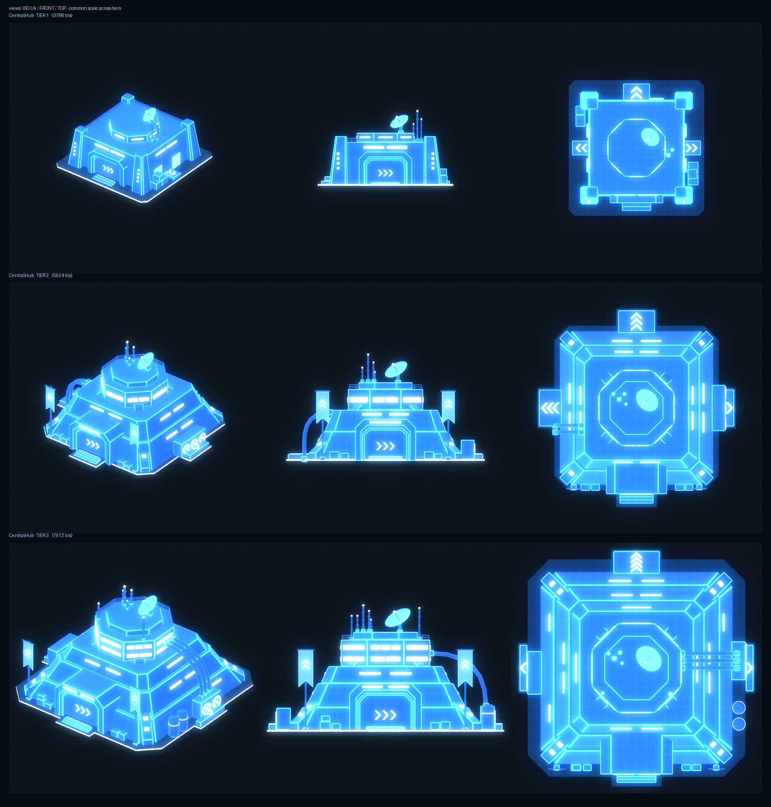

# Узлы базы — голограммы для проектора и рендеры для экранов терминала

Узел базы показывается в трёх видах. Все три собираются из одной спецификации, [`nodes.json`](nodes.json):

| Где | Что | Файлы |
|---|---|---|
| Проектор командного центра, **один узел** | 3D-голограмма, вписана в объём проектора | `export/SM_Holo_<Node>_T<n>.fbx` |
| Проектор, **2–5 узлов** | облегчённые голограммы в общем масштабе | `export/SM_Holo_<Node>_T<n>_Mini.fbx` |
| Экраны терминала | заготовленный рендер с 3D-модели (изометрия, прозрачный фон) | `ue/screens/T_Node_<Node>_T<n>_Screen.png` (1280 × 800, + `_640`) |
| Списки / карта в UI | иконка с концепт-арта | `icons/T_Node_<Node>_T<n>_Icon_{512,256,128,64}.png` |

Готов первый узел — **Центральный хаб** (`central_hub`), уровни 1–3, по концептам из [`reference/`](reference/).
Анимации смены уровня нет: уровень — это отдельный меш, смена — простая замена меша.



## 1. Как устроено: модульный набор + сборка скриптом

Узел описывается списком модулей (`nodes.json → nodes.<id>.tiers.<n>.modules`), а `blender/build_nodes.py`
собирает его в один меш. Типы модулей (код — [`blender/bn_kit.py`](blender/bn_kit.py)):

| Модуль | Что это | Хаб |
|---|---|---|
| `plate` | плита-основание: квадрат или крест, светящийся контур, внутренняя часть затемнена | все уровни |
| `mass` | наклонный ярус (усечённая пирамида), `strips` — световые окна на гранях | T1: 1 ярус, T2: 2, T3: 3 |
| `pylons` / `buttresses` | угловые пилоны (T1) / диагональные контрфорсы до башни с огнями | T1 / T2–T3 |
| `gate` | портал: внешняя и внутренняя рамы, панель с `>>>`, световые полосы, ступени | все |
| `arm` | низкие крылья плиты с шевронами наружу | все |
| `tower` | восьмигранная башня с поясами окон (+ корона) | T1 — низкий восьмигранник на крыше, T2–T3 — башня |
| `dish`, `antennas`, `banner` | тарелка, мачты с огнями, флаги с шевронами | все / T2–T3 |
| `fans`, `tanks`, `pipes`, `shutter`, `crates`, `railing` | вентиляторный блок, баки, трубы, ворота, ящики, ограждения | по уровню |

**Постоянные приметы узла на всех уровнях:** портал с `>>>` и ступенями, восьмигранник на крыше, тарелка (смотрит вперёд-влево),
группа антенн, светящийся контур плиты. Уровень 1 по сравнению с концептом подтянут к ряду T2–T3: вместо
квадратного короба на крыше стоит низкий восьмигранник с поясом света, чтобы повышение уровня читалось как «достроили».

**Новый узел** = новая запись в `nodes.json` (модули из того же набора) + концепт в `reference/` для иконки.
Новый тип детали добавляется функцией в `bn_kit.py` и строкой в `BUILDERS`.

### Как голограмма выглядит без текстур

В мешах нет UV-текстур. Всё задают цвета вершин и один мастер-материал:

| Канал цвета вершин | Значение | Откуда |
|---|---|---|
| **R** — ребро | 1 на фасках твёрдых рёбер (угол > 35°) → яркие линии по контуру форм | фаска `bmesh.bevel`, ширина задана **в мм на голограмме** (`display.rim_mm` = 6) и пересчитана в метры модели по масштабу показа |
| **G** — свечение | окна, шевроны, контур плиты, кольца вентиляторов, огни мачт | детали-«светильники» |
| **B** — приглушение | 1 на внутренней части плиты: она тёмная, читается только контур | плита |

Материал (`MM_HoloSolid`, превью — `blender/bn_render.py`) неосвещённый. Его свечение складывается из трёх слагаемых:
- **заливка корпуса**, тёмно-синяя: ложный свет по нормали (верх светлее) плюс сетка панелей 2 м в координатах объекта;
- **рёбра и края по Френелю**, голубые;
- **светящиеся детали**, почти белые.

Поверх идут медленные сканлинии. Голограмма непрозрачная, поэтому проблем с сортировкой нет.

| Меш | Треугольники | Масштаб «один узел» | Фаска, м модели |
|---|---|---|---|
| `SM_Holo_CentralHub_T1` / `_Mini` | 3 788 / 2 848 | 0,0527 (1 : 19) | 0,114 / 0,564 |
| `SM_Holo_CentralHub_T2` / `_Mini` | 5 624 / 4 400 | 0,0454 (1 : 22) | 0,132 / 0,564 |
| `SM_Holo_CentralHub_T3` / `_Mini` | 7 512 / 5 948 | 0,0347 (1 : 29) | 0,173 / 0,564 |

`_Mini` — без ограждений, ящиков, труб и планок ворот, мачты вдвое толще, фаски под мелкий масштаб.
Пять узлов на проекторе — это ≤ 30 тыс. треугольников.

## 2. Проектор: один узел и до пяти

Объём взят из модели командного центра (`art/command_center/blender/interior_model.py`). Отсчёт идёт от `SOCKET_holo`:
низ голограммы на −0,93 м (верх диска эмиттера), радиус 1,0 м (внутри шкалы r 1,17), высота ≤ 1,0 м.

- **Один узел** — меш уровня вписан в объём; у каждого уровня свой масштаб (`ScaleSingle` в таблице). Голограмма T1 занимает
  платформу так же, как T3. Размеры показывает UI.
- **2–5 узлов** — `_Mini`-меши в **одном общем масштабе на раскладку**: самая большая плита из всех узлов и уровней заполняет
  слот (`slot_radius × margin`), поэтому T3 рядом с T1 честно больше. Раскладки (`display.multi.layouts`): 2 — рядом,
  3 — треугольник, 4 — квадрат, 5 — центр + 4 вокруг (слот 0 в центре — для хаба).

| Узлов | Радиус слота | Масштаб | T3 / T1 на проекторе, радиус |
|---|---|---|---|
| 2 | 0,50 м | 0,0160 | 0,46 / 0,30 м |
| 3 | 0,46 м | 0,0148 | 0,43 / 0,28 м |
| 4 | 0,41 м | 0,0132 | 0,38 / 0,25 м |
| 5 | 0,33 м | 0,0106 | 0,31 / 0,20 м |

Макеты с точки зрения игрока у пульта: [`renders/review_projector_single_T3.png`](renders/review_projector_single_T3.png),
[`_single_T1`](renders/review_projector_single_T1.png), [`_multi5`](renders/review_projector_multi5.png)
(в макете «5 узлов» пока есть только хаб, остальные слоты — его уровни как заглушки).

## 3. Экраны и иконки

- **Рендер для экранов** — `ue/screens/T_Node_<Node>_T<n>_Screen.png`: изометрия «вид А» (спереди-справа сверху,
  как на концепте), ортокамера вписана в модель, прозрачный фон, свечение добавлено в альфу. Картинка ложится на любой тёмный
  фон виджета. Перерендер: `build_nodes.py --screens ../ue/screens`.
- **Иконка** — пиктограмма с концепта (панель «2D иконка»): `tools/make_icons.py` вырезает её из оранжевой рамки
  и выравнивает края; заливка однотонная, с лёгким градиентом и мягким свечением. Рамка и полоска уровня под иконкой —
  состояние UI, их рисует виджет. Исходник на концепте ≈ 200 px, поэтому 256 и меньше чёткие; 512 — увеличение. Для
  по-настоящему резкой 512 пиктограмму нужно перерисовать в векторе.
- Текста в текстурах нет. Название и тип («Central Hub» / «Центральный хаб», «Control / Coordination») хранятся в
  таблице как `FText` (`NSLOCTEXT("FicsitAIHelper.BaseNodes", "central_hub.name" / ".type", …)`). Русские строки —
  в `nodes.json → display_name / type_label → ru`, в `.po` их вносят так же, как тексты командного центра (`art/command_center/ue/README_UE.md` §6).

## 4. UE

| Файл | Что |
|---|---|
| [`ue/ue_import_base_nodes.py`](ue/ue_import_base_nodes.py) | `--import`: строит мастер `MM_HoloSolid` (один Custom-узел HLSL + параметры) и `MI_HoloSolid`; импортирует меши (цвет вершин Replace, без Nanite и коллизии, MI на слот 0), рендеры экранов и иконки (группа UI, без мипов). `--table`: `DT_BaseNodes` из `ue/base_nodes_table.json`. `--verify`: что есть / чего нет |
| `ue/base_nodes_table.json` | строки таблицы (пишет сборка): `central_hub_T1..T3` → пути к мешам и текстурам, `PlateRadius`, `Height` (см), `ScaleSingle` |
| `ue/Source/FicsitAIHelper/Public/Holo/FAIHBaseNodeTypes.h` | `FFAIHBaseNodeVisual` (строка таблицы), `FFAIHBaseNodeRef`, `FFAIHHoloLayout` |
| `ue/Source/.../Holo/FAIHHoloNodeDisplayComponent.{h,cpp}` | компонент проектора: `ShowSingle(NodeId, Tier)`, `ShowMulti([...до 5])`, `Clear()`, `SetPowered()`, `GetVisual()` для UI; до 5 дочерних мешей, MID на слот (`Intensity` для приглушённых узлов) |

Типы игры в этом коде не используются, поэтому он лежит вне `GameFacade/`. Проверка ADR-021 (`tools/ci/check_adr021.py`)
по всем `Source/`: 6 файлов, 0 нарушений.

Порядок в редакторе:
1. Скопировать `ue/Source/...` в модуль мода и собрать.
2. Выполнить `py ".../ue_import_base_nodes.py" --import`, затем `--table`.
3. У командного центра добавить `UFAIHHoloNodeDisplayComponent` на `SOCKET_holo` и задать `NodeTable = DT_BaseNodes`. Центральную
   «кристальную» часть `SM_CommandCenter_HoloSpin` при показе узлов скрыть. Это правка `AFAIHCommandCenter`, отложена
   вместе с командным центром.

**Проверено без редактора:**
- `art/command_center/ue/tools/ue_stub_dryrun.py --script ue/ue_import_base_nodes.py --modes=--import,--table,--verify --compiled-modes=--table`
  на стабе UE 5.6.0: все режимы без падений, 19 вызовов API, **0 расхождений**. Без собранного C++ остаётся один ручной шаг:
  «сначала скомпилировать модуль».
- **В настоящем редакторе не запускалось.** Там нужно проверить: компиляцию HLSL Custom-узла (вход `VertexColor`, векторные
  параметры через `.rgb`), чтение `NSLOCTEXT` при импорте `FText` из JSON и вид голограммы при игровой экспозиции и bloom
  (параметры `FillColor`, `EdgeColor`, `GlowColor`, `Intensity` в `MI_HoloSolid`).

## 5. Команды

```bash
cd art/base_nodes/blender
python build_nodes.py                                   # меши + manifest + ue/base_nodes_table.json
python build_nodes.py --screens ../ue/screens           # + рендеры для экранов
python build_nodes.py --render ../renders --review      # + лист уровней и макеты проектора
python build_nodes.py --tiers 2 --screens /tmp/s        # быстрый прогон одного уровня
```

```bash
python3 art/base_nodes/tools/make_icons.py              # иконки из концептов
```

```bash
python3 art/base_nodes/tools/fmt_json.py art/base_nodes/nodes.json   # переформатировать спецификацию
```

Нужен Python с модулем `bpy` 5.2 (или `blender -b -P build_nodes.py -- …`) и Pillow. Полная сборка с рендерами — ≈ 25 с.
