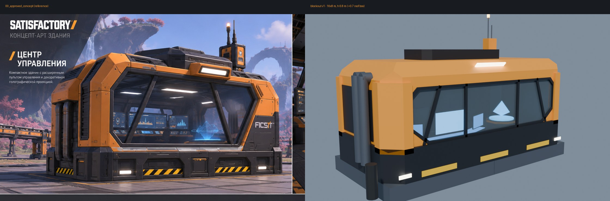

# Command Center — флагманский AI Terminal (FR-01)

Размещаемое здание, через которое игрок открывает общий UI-контроллер (ARCHITECTURE §6.1).
Игрок заходит внутрь, смотрит на пульт, нажимает **E**, и открывается полноэкранный UMG
с пресетом `slots-3`. Для массовой расстановки позже будет отдельный **компактный терминал**.
Это здание рассчитано на одну-две штуки на карте.

Статус: **блокаут v1**, этап 1 из плана ниже.



## Принятые решения

| Параметр | Решение | Почему |
|---|---|---|
| Габарит | **16 × 8 м = 2 × 1 фундамента** | пропорция ~2:1 на всех видах концепта, кратно сетке 8 м |
| Высота | корпус 6,8 м, короб на крыше +0,7 м, антенна ~10,3 м | пропорции фронтального вида 00 |
| Цоколь | тёмная полоса 0–2 м («цоколь 2 м» с листа модулей) | подоконник = пол + 1 м, удобно для пульта |
| Пол | +1,0 м над фундаментом, чистая высота 4,8 м | |
| Вход | одна дверь **сзади**, на уровне земли; 4 ступени по 0,25 м — **внутри** (приямок у задней стены) | фасад с окном остаётся чистым, лестницы снаружи нет, за габарит ничего не выступает |
| Бока | слева (−X) трубы, справа (+X) вентблок | как на виде 3/4 в концепте 00 |
| Окно | широкий восьмиугольный проём, 2 вертикальные и 2 наклонные стойки — **5 сегментов** | наклонные стойки расходятся книзу, как на концепте 00. Наклон стекла ~15° — на этапе 3 |
| Пульт | спереди слева: прямой центр и два крыла по 22° | |
| Голостол | спереди справа, восьмигранник Ø 2,5 м | |
| Экран render target | `DISPLAY_MAIN_RT`: 2,4 × 1,35 м, **16:9**, свой слот материала, UV 0–1 | ARCHITECTURE §6.6, Spike S4 |
| Питание | `POWER_SOCKET` + пустышка `SOCKET_power` сзади | решение «нужно ли питание» открыто (§6.1). Если не нужно, остаётся декором |

Внутренняя раскладка зеркальна интерьерному кадру концепта (там пульт слева, если смотреть
изнутри на окно). Это сделано намеренно: эталоном считается внешний вид 00, где снаружи
пульт слева, а голограмма справа.

## Система координат и именование

- Метры, Z вверх, 1 unit = 1 м. FBX экспортируется с `FBX_SCALE_UNITS`: проверить при первом импорте, что в UE здание получилось 1600 × 800 см.
- **Pivot** — центр пятна на уровне верха фундамента (Z = 0).
- Фронт (окно) смотрит в **−Y**, дверь в **+Y**.
- Имена объектов совпадают с разбиением из `reference/README_modeling.md`:
  `BASE, FLOOR, STEPS_*, MAIN_SHELL, CORNER_ARMOR_*, ROOF, WINDOW_FRAMES*, WINDOW_GLASS,
  BACK_PANEL, SIDE_PANEL_*, DOOR, POWER_SOCKET, CONSOLE_BODY_*, CONTROL_PANELS_*,
  DISPLAY_FRAMES_*, DISPLAY_MAIN_RT, DISPLAY_PLANES_*, HOLO_PEDESTAL*, HOLO_EMITTER,
  HOLO_PROJECTION, EXHAUST_PIPES_*, VENTS_*, BEACON_*, LIGHTS_*, DECALS_*, PROP_CHAIR`.
- Коллекция `REF_NOT_EXPORTED` не экспортируется. В ней фундаменты 8 × 8 × 1, капсулы игрока 1,8 м,
  зона взаимодействия `USE_ZONE_console` (будущая коллизия для E) и пустышка `SOCKET_power`.

## Слоты материалов

Имена слотов стабильны: в UE на них назначаются инстансы материалов.

| Слот | Назначение в UE |
|---|---|
| `M_PaintOrange`, `M_MetalDark`, `M_MetalLight`, `M_Rubber`, `M_Hazard` | заводской мастер-материал игры с масками покраски (primary/secondary), чтобы здание красилось Покрасочной пушкой |
| `M_Glass` | полупрозрачное стекло |
| `M_ScreenRT` | материал с render target экрана в мире |
| `M_ScreenStatic` | эмиссивные экраны с panner-анимацией |
| `M_Holo` | голограмма: эмиссия + прозрачность |
| `M_LightWarm`, `M_Beacon` | светильники и маяк |

Цвета блокаута взяты из палитры референсов: FICSIT Orange #F79A22, Industrial Gray #2E3238,
Metal Light #5E6770, Metal Dark #1C1E22, Warning #FFD200, Emissive #FFF4D6.

## Сборка

Нужен Blender 5.2 LTS или wheel `bpy==5.2.3` (Python 3.13).

```bash
cd art/command_center/blender
blender -b -P build_blockout.py -- --out ../export --render ../renders
# либо: python build_blockout.py --out ../export --render ../renders [--blend] [--samples 48]
```

Скрипт полностью воспроизводит `export/SM_CommandCenter_Blockout.{fbx,glb}` и `renders/*`.
Рендеры сохраняются в PNG; в репозитории лежат их JPG-копии.

## Содержимое

| Путь | Что |
|---|---|
| `blender/build_blockout.py` | процедурный блокаут: единственный источник геометрии на этом этапе |
| `export/` | FBX для UE, GLB для просмотра |
| `renders/` | 3/4, четыре ортогональных вида, сверху, интерьер, сравнение с концептом |
| `reference/` | пакет референсов (JPG ≤ 2400 px, без изменений по содержанию) и `README_modeling.md` |

## Внешние референсы и лицензии

[Satisfactory-KMods/public-source](https://github.com/Satisfactory-KMods/public-source):

- **Ассеты `/Content` использовать нельзя.** `LICENSE-ASSETS` запрещает распространение,
  использование в других модах и производные работы без письменного разрешения автора (Kyrium).
  Модели, текстуры и материалы оттуда в этот репозиторий не копируются и не воспроизводятся.
- **Код (MIT) можно** использовать с атрибуцией. Образец взаимодействия по E —
  `KPrivateCodeLib/.../Network/Buildings/KPCLNetworkTerminal.{h,cpp}`
  (`IsUseable` / `OnUse` / `GetLookAtDecription`). Заимствованный код размещается в `third_party/`
  по правилу из корневого README.

## План работ

| # | Этап | Статус |
|---|---|---|
| 0 | Структура `art/`, референсы | ✅ |
| 1 | Блокаут: скрипт, FBX/GLB, рендеры, сравнение с концептом | ✅ v1 |
| 2 | Проверка в игре: масштаб относительно игрока, дверь и ступени, обзор изнутри, дистанция E до пульта | ждёт импорта в UE |
| 3 | Корпус: крупные фаски, массивные угловые пилоны, наклон стекла 15°, рамы, трубы, вентиляция, маяк, панели | |
| 4 | Интерьер: детализированный пульт, мониторы, голостол, потолок, разметка пола | |
| 5 | UV: trim sheet корпуса, UV экранов, маски покраски | |
| 6 | LOD0/1/2 (на LOD2 нет интерьера, стекло непрозрачное), UCX-коллизии, clearance | |
| 7 | UE 5.6: материалы, render target, класс здания, голограмма, иконка, рецепт | |
| 8 | Профилирование, сверка с концептом в игре | |

### Известные отличия блокаута от концепта (закрываются на этапе 3)

- Фронтальная фаска крыши и угловые пилоны у концепта массивнее, а короб на крыше ступенчатый.
- Окно у концепта выше относительно корпуса и уходит под верхнюю фаску.
- На цоколе нет панелей с болтами и световых ниш, полосы на нём пока сплошным цветом.
- Наклон стекла и внутренняя обшивка не сделаны.
