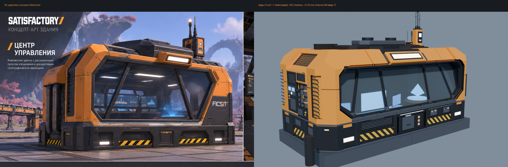

# Command Center — флагманский AI Terminal (FR-01)

Размещаемое здание, через которое игрок открывает общий UI-контроллер (ARCHITECTURE §6.1).
Игрок заходит внутрь, смотрит на пульт, нажимает **E**, и открывается полноэкранный UMG
с пресетом `slots-3`. Для массовой расстановки позже будет отдельный **компактный терминал**.
Это здание рассчитано на одну-две штуки на карте.

Статус: **этап 3 (корпус) готов**. Интерьер пока из блокаута. Этап 2 (проверка в живом UE)
**отложен**, модель условно принята — см. [«Требует уточнения»](#требует-уточнения).



## Принятые решения

| Параметр | Решение | Почему |
|---|---|---|
| Габарит | **16 × 8 м = 2 × 1 фундамента** | пропорция ~2:1 на всех видах концепта, кратно сетке 8 м |
| Высота | корпус 6,8 м, короб на крыше +0,7 м, антенна ~10,3 м | пропорции фронтального вида 00 |
| Цоколь | тёмная полоса 0–2 м («цоколь 2 м» с листа модулей) | подоконник = пол + 1 м, удобно для пульта |
| Пол | +1,0 м над фундаментом, чистая высота 4,8 м | |
| Вход | одна дверь **сзади**, проём **2,4 × 3,2 м** на уровне земли (в блокауте был 2,0 × 2,8 — на обходе читался как люк); 4 ступени по 0,25 м — **внутри** (приямок у задней стены); дверь — часть отдельного заднего сервисного модуля | фасад с окном остаётся чистым, лестницы снаружи нет, за габарит ничего не выступает; проём с запасом под игрока с рюкзаком/джетпаком |
| Бока | слева (−X) трубы, справа (+X) вентблок | как на виде 3/4 в концепте 00 |
| Окно | широкий восьмиугольный проём до 5,6 м, заходит под верхнюю фаску; 2 вертикальные и 2 наклонные стойки — **5 сегментов**; стекло наклонено на **15° внутрь** (верх утоплен на ~0,9 м) | наклонные стойки расходятся книзу, как на концепте 00. Наклон внутрь не выводит стекло за габарит |
| Угловые пилоны | оранжевая обшивка 0,18 м, охватывает по 2,2 м каждой грани; на переднем левом пилоне — тёмная жалюзийная полоса | массивные углы концепта 00 |
| Цоколь | стоит на тёмной **монтажной плите 0,15 м на болтах** — единственной части, доходящей до края 16 × 8; весь цоколь отодвинут от края на 0,12 м, под модулями теневой уступ до z 0,3 — здание читается «поставленным на платформу». На каждой грани один ритм: **угол → промежуточный → центральный → промежуточный → угол** | ритм цоколя концепта 00 + ТЗ по основанию |
| Трубы | три калибра (Ø 0,44 / 0,30 / 0,16 м) в утопленном лотке левой стены (глубина 0,26 м), наружная поверхность ровно в габарите 16 м | чтобы трубы стояли отдельно от стены на кронштейнах, а не были вдавлены в неё |
| Логотип | заглушка `DECALS_logo` в тёмной утопленной панели на 45°-грани правого переднего пилона, над ней две прорези | фронтальную грань пилона почти целиком занимает окно |
| Проход детализации | тёмный ступенчатый откос вокруг окна; сегментированный подоконник; швы по пилонам (z 4,35) и через крышу (x ±3,4); утопленные жалюзи на боковых фасках и на левом пилоне; оранжевый корпус прожектора с тёмной рамкой; задний световой блок; боковой модуль слева, в который уходят трубы (фланцы, оранжевые хомуты); пилястры, карниз, угловые блоки и люки цоколя, янтарные индикаторы; решётки и люк короба крыши; маяк с лампой на центральной мачте; рёбра на задних панелях | сверка фрагментов концепта 00 и листа «Детали и узлы» |
| Проход детализации 2 | задняя стена целиком в тёмных панелях до задней фаски: накладные плиты, кабель-каналы с хомутами, рёбра, распределительная коробка, панель над дверью; створки двери с жалюзи и ручками, полосы на откосах; цоколь на всех четырёх гранях по одной схеме (сзади: световые блоки, боксы с полосами, модуль с разъёмом питания; с боков: бокс с полосами по центру); янтарные маркеры на пилястрах и угловых блоках; жалюзи на трёх пилонах; справа — шкаф оборудования с жалюзи, дверцей, ручкой и табличкой | сверка с ортогональными видами листа 01 ([сравнение сзади](renders/stage3/00_compare_back.jpg)) |
| Проход 3: фронт | **верхний пояс** собран из отдельных оранжевых секций 7 см (2,15 / 1,34 / [гнездо прожектора 4,2] / 1,92 / 1,57 м — ширины намеренно неравные) с тёмными швами; прожектор сидит в тёмном посадочном гнезде на светлых скобах. **Нижний пояс**: центр — главный сервисный блок (выступающий корпус, ниша с крышкой на двух замках, панель из трёх разъёмов, статус-экран, световая полоса, полосы на откосах); слева — вентиляционный бокс (широкая жалюзийная решётка), справа — силовой (кабель-канал, два щитка с табличками и индикаторами, кабельные вводы). **Окно**: откос 0,17 м + выступающая тёмная рама, стойки 0,2 м, болтовые узловые пластины на стыках стоек с рамой, кронштейны со стойками-раскосами под нижней кромкой стекла | ТЗ по фронту ([деталь](renders/stage3/08_front_detail.jpg)) |
| Проход 4: задник | задняя стена разбита по функциям (на виде сзади слева направо): **силовой шкаф** (две створки со швами, ручки, табличка, колонка автоматов с индикаторами, вентпрорези, оранжевая крышка) → **зона кабельного ввода** (короб ввода, три кабеля с хомутами вниз к разъёму питания в цоколе) → **сервисный дверной модуль** во всю высоту двери (выступ 0,16 м, массивная светлая рама 0,3 м, свет в пазу под козырьком, считыватель с экраном, клавиатурой и LED, рёбра на щеках, полосы на откосах) → **охлаждающий блок** с двумя вентиляторами (кожух, лопасти, ступица, решётка). Над модулем **верхняя полоса из трёх секций разной глубины**: обслуживаемый отсек с люком на петлях (0,10–0,13) · радиатор с вертикальными рёбрами (0,16, самый глубокий) · техпанель с приборами, тумблерами и LED (0,06). Под всем — тёмная фоновая обшивка; задний световой блок на фаске выровнен по двери. Новый ракурс `09_rear_three_quarter` | ТЗ по заднику ([сравнение](renders/stage3/00_compare_back.jpg), [3/4 сзади](renders/stage3/09_rear_three_quarter.jpg)) |
| Проход 5: левый бок | **левый бок — инженерный, правый — вторичный и чище.** Слева внешний utility cluster: **насосно-силовой блок** на карнизе цоколя (люк, табличка, LED) → **три трубы разного калибра** в лотке: магистраль Ø 0,44 с фланцами по сегментам и оранжевыми хомутами · Ø 0,30 с задвижкой и маховиком · тонкая Ø 0,16 в изоляционных кольцах → обе толстые уходят вверх в **оранжевый коллектор-радиатор** с жалюзи, тонкая через колено поворачивает во **вертикальный техблок** (воздухозаборник, приборная панель с двумя экранами и циферблатом, сервисный люк на замках, оранжевые крышки сверху и снизу). Каждый хомут — на кронштейне с пластиной в задней стенке лотка. Вентиляция слева усилена: решётка на боковой фаске 3,3 м, 7 ламелей, оранжевый козырёк; справа решётка уменьшена до 2,0 м, 4 ламели. Новый ракурс `10_left_three_quarter` | ТЗ по левому боку ([3/4 слева](renders/stage3/10_left_three_quarter.jpg)) |
| Проход 6: правый бок и антенна | **правый бок — электрощитовая и узел связи, без труб.** Светло-серый двустворчатый электрошкаф (утопленные поля створок, петли, ручки, смотровое окно, табличка с полосами, шильдик) — по цвету противопоставлен тёмному левому кластеру; **вентиляция другой формы**: полоса с четырьмя круглыми вытяжными решётками над шкафом, решётка на правой фаске уменьшена (1,4 м) и сдвинута вперёд; **вертикальная кабельная ниша** (врезана в стену на 0,2 м): лоток, три кабеля, хомуты, вводной короб внизу, крышка на кромке стены → кабельный короб по боковой фаске → **лоток по крыше к пьедесталу антенны**; **интерфейсный блок** с экраном, клавиатурой, LED и оранжевым козырьком, под ним кабельный ввод. **Антенна как узел связи**: ступенчатый пьедестал на болтах, корпус маяка поднят на него и стоит на одной оси со стояком (x 5,15, y 0,6); рядом техбокс связи (тёмный корпус, оранжевая крышка, прорези, LED, панельная антенна на штанге, штыревая антенна), соединён с пьедесталом патрубком; кабель-канал к коробу крыши. Новый ракурс `11_right_three_quarter` | ТЗ по правому боку ([3/4 справа](renders/stage3/11_right_three_quarter.jpg), [крыша](renders/stage3/12_roof_comms_detail.jpg)) |
| Проход 7: крыша | **четыре зоны, пять ясных элементов, без мелочи.** Передняя зона над стеклом намеренно чистая (только оранжевые секции и прожектор). (1) **Центральный техмодуль** компактнее и ступенчатый: тёмный цоколь 8 × 3 м с решётками спереди и плоскими сервисными накладками на плечах → светлый средний ярус → два круглых вентиляторных модуля (кожух, кольцо, лопасти, решётка) — самая высокая точка крыши; (2) **люк обслуживания** в раме с петлями и полосами — в задней зоне на оси двери; (3) **низкий охладительный блок** (светлая крышка, рёбра назад, LED) — над охлаждающим блоком задней стены; (4) **тонкий кабельный канал** вдоль задней грани модуля от охладителя к узлу связи; (5) **антенный узел** с пьедесталом и техбоксом (проход 6), связан с модулем кабель-каналом. Высотные отметки: крыша 6,8 → канал 6,88 → накладки 7,17 → охладитель 7,27 → ярус 7,55 → вентиляторы 7,8 → маяк ~10,5. Новый ракурс `13_roof` | ТЗ по крыше ([крыша](renders/stage3/13_roof.jpg)) |
| Проход 8: основание | **конструктивный ритм** на всех гранях: спереди угол · вент-бокс · сервисный блок · силовой бокс · угол; сзади угол · вент-бокс · дверной модуль · силовой бокс с разъёмом питания · угол; слева (техническая сторона) угол · вент · бокс с полосами · вент · угол; справа (чистая сторона) угол · люк · бокс с полосами · люк · угол. **Угловые опоры** — массивные Г-блоки 1,7 м на каждую грань, выше карниза (до 2,05), со световой нишей, горизонтальным швом, янтарным маркером на 45°-грани и анкерными болтами. Пилястры стоят прямо на плите, у каждой два анкерных болта. **Стык с фундаментом**: тёмная монтажная плита 0,15 м на всю площадь 16 × 8 со швами по половинам фундаментов, отступ цоколя 0,12 м, теневой уступ под модулями. Разъём питания перенесён в силовой бокс сзади | ТЗ по основанию ([деталь](renders/stage3/14_plinth_detail.jpg)) |
| Проход 9: унификация | 13 финальных слотов материалов (добавлены `M_PaintGray`, `M_MetalBare`, `M_Decal`; швы переведены в `M_Rubber`); резиновые уплотнители стекла, двери, сервисной крышки и люка; фаски сведены к трём уровням; рамки к двум толщинам (рама двери 0,30 → 0,24, безель 0,15 → 0,12, поля вент-решёток 0,30 → 0,24, рамы люков → 0,12); все притоки — одна серия жалюзи (было 6 разных шагов 0,08–0,27, вертикальные рёбра и прорези), вытяжки — круглые; оранжевые секции с гнездом под свет повторены на задней фаске, козырьки над решётками на обеих боковых фасках; рендер по материалам | ТЗ по единому языку ([зоны материалов](renders/stage3/15_material_zones.jpg)) |
| Проход 10: замечания по облёту | **задняя дверь** 2,0 × 2,8 → 2,4 × 3,2 м, сервисный модуль расширен до 3,9 м, охлаждающий блок и кабельная зона сдвинуты; **вентблок крыши**: низкий бортик по контуру яруса (+0,1 м, силуэт не вырос), четыре опорные лапы с болтами у каждого вентилятора, защитные решётки из пяти прутков с поперечиной; **серая накладка** на левом плече модуля → сервисный люк в утопленной раме: крышка, резиновый уплотнитель, две петли, два замка, ручка, предупреждающий знак и табличка; правая накладка убрана, чтобы не плодить элементы на крыше | замечания к облёту |
| Проход 11: финальный по сторонам | **фронт**: болты по углам оранжевых секций, табличка модуля на поясе, маркировка вент- и силового бокса (подпись + знак); **правый бок**: шкаф и интерфейсный блок соединены со стояком патрубками с сальниками — каждый кабель видимо уходит в стояк → фаска → лоток → антенна; **задник**: резиновые стыковые накладки между охлаждением, дверным модулем, кабельной зоной и шкафом + горизонтальный стык над модулем; **левый бок**: две серые опорные балки поперёк лотка с настенными пластинами на болтах и U-хомутами на каждой трубе; **крыша**: такелажные проушины на углах модуля, сервисные панели на кожухах вентиляторов; **основание**: скрипт `check_fit.py` — нашёл и устранил выступы за габарит до 4 см (фланцы труб, сальники, ручки, автоматы, защёлки). Крупные планы `16…20_detail_*` | таблица оценок по сторонам |
| Пульт | спереди слева: прямой центр и два крыла по 22° | |
| Голостол | спереди справа, восьмигранник Ø 2,5 м | |
| Экран render target | `DISPLAY_MAIN_RT`: 2,4 × 1,35 м, **16:9**, свой слот материала, UV 0–1 | ARCHITECTURE §6.6, Spike S4 |
| Питание | `POWER_SOCKET` + пустышка `SOCKET_power` сзади | решение «нужно ли питание» открыто (§6.1). Если не нужно, остаётся декором |

Внутренняя раскладка зеркальна интерьерному кадру концепта (там пульт слева, если смотреть
изнутри на окно). Это сделано намеренно: эталоном считается внешний вид 00, где снаружи
пульт слева, а голограмма справа.

## Система координат и именование

- Метры, Z вверх, 1 unit = 1 м. FBX экспортируется с `FBX_SCALE_UNITS`: проверить при первом импорте, что в UE здание получилось 1600 × 800 см.
- **Pivot** — центр пятна на уровне верха фундамента (Z = 0).
- Фронт (окно) смотрит в **−Y**, дверь в **+Y**.
- Имена объектов совпадают с разбиением из `reference/README_modeling.md`:
  `BASE, FLOOR, STEPS_*, MAIN_SHELL, CORNER_ARMOR_*, ROOF, WINDOW_FRAMES*, WINDOW_GLASS,
  BACK_PANEL, SIDE_PANEL_*, DOOR, POWER_SOCKET, CONSOLE_BODY_*, CONTROL_PANELS_*,
  DISPLAY_FRAMES_*, DISPLAY_MAIN_RT, DISPLAY_PLANES_*, HOLO_PEDESTAL*, HOLO_EMITTER,
  HOLO_PROJECTION, EXHAUST_PIPES_*, VENTS_*, BEACON_*, LIGHTS_*, DECALS_*, PROP_CHAIR`.
- Коллекция `REF_NOT_EXPORTED` не экспортируется. В ней фундаменты 8 × 8 × 1, капсулы игрока 1,8 м,
  зона взаимодействия `USE_ZONE_console` (будущая коллизия для E) и пустышка `SOCKET_power`.

## Интерьер (этап 4)

Источник — лист концепта интерьера (главный и обратный ракурс, план, компоновка пульта, разрез, модули).
Код — `blender/interior_model.py`, вызывается из `build_model.py`; `cc_interior.py` остался только для блокаута.

| Вопрос | Концепт | Модель | Решение |
|---|---|---|---|
| Размер помещения | ≈ 9,8 × 5,6 м, высота ≈ 2,7 м | 14,9 × 6,9 м, чистая высота 4,8 м | размеры задаёт утверждённый корпус; масштаб «собирают» балки потолка и светильники |
| Пульт / голограмма | при взгляде на окно: пульт слева, голограмма справа | снаружи пульт слева (−X), голограмма справа | как и на этапе 1, эталон — внешний вид; изнутри раскладка зеркальна |
| Голоплатформа | в центре зоны, проектор на потолке | центр правой половины (x 3,2), потолочный проектор в пролёте между балками, луч из 12 световых полос | |
| Остекление | ≈ 62° | 15° внутрь (корпус) | не менялось |

| Модуль (лист концепта) | Что сделано |
|---|---|
| Модуль пульта (v2) | **самый проработанный элемент интерьера.** Под стоящего оператора (игрок ~1,8 м): тело 0,94 м, мягкий резиновый подлокотник с оранжевой кромкой и подсветкой 0,90–1,02, наклонная дека 1,0 → 1,18 (20°), задняя полка 1,19, рельс экранов. **Модули**: центр 3,2 м + два крыла 1,8 м под 25°, на стыках — стыковые пилоны с оранжевой крышкой и световой полосой, **края асимметричны**: слева — высокая **техбашня** 1,75 м (жалюзи, колонка индикаторов, статус-экран, люк, кабельные вводы, оранжевая крышка, полоса hazard), справа — низкий **шкаф накопителей** на высоте стола (три одинаковых отсека картриджей со слотом, ручкой и индикатором, рабочая столешница с оранжевой кромкой). **Панели управления — повторяющиеся промышленные модули** (одна плита 0,44 × 0,36, табличка внизу, одинаковое расположение): центр — сенсорная панель + **4 клавишных модуля** (3 × 2 клавиши + 3 индикатора); левое крыло — **3 тумблерных модуля** (3 тумблера в одной жёлто-чёрной защитной рамке + 3 индикатора); правое крыло — **3 модуля поворотных ручек** (дисплей-полоса + 2 ручки с метками). **Секции обслуживания снизу**: центр — сервисный люк · встроенный серверный блок (жалюзи + стойка индикаторов) · сервисный люк; крылья — вент-модуль и кабельный модуль с гнёздами; между модулями пилястры, понизу полоса hazard и ниша-цоколь |
| Блок мониторов (v3) | **композиция высот**: общая нижняя линия 1,28 м для всех нижних экранов; **главный** `DISPLAY_MAIN_RT` **2,6 × 1,46** (16:9, render target; после проверки масштаба уменьшен с 3,0 м, чтобы верх был ≤ 40° над глазами стоящего игрока) — вдвое шире экранов крыльев и задаёт верхнюю линию 2,74 м (узкие вертикальные экраны по бокам убраны); **крылья**: нижний 1,3 × 0,73 и верхний 0,9 × 0,51 с наклоном 12° к оператору, верх на 5 см ниже верха главного; верхние экраны стоят на **мачтах, закреплённых на корпусе своей секции** (хомут на задней стенке, кронштейн VESA); несущая балка и стойки за главным экраном. **Превью-графика вместо белых заглушек** (`blender/ui_preview.py`, текстуры `textures/preview/`, подменяется только на этапе рендера после экспорта — в FBX/GLB остаются штатные `M_ScreenRT` / `M_ScreenStatic` / `M_Decal`): главный экран — AI Terminal (карта, диалог ассистента, производство, энергия, статусы); крылья — тренд энергосети, очередь производства, камера площадки; малые экраны (служебная консоль, пульт двери, техбашня, модуль управления проектором, пояс под окном, сенсорная панель) — статус-экраны; все таблички `M_Decal` — тёмные плашки с оранжевым флажком и маркировкой (узел, ID, предупреждение); надписи зон на полу — трафарет OPERATOR / SERVICE / HOLO / TECH; над дверью — вывеска COMMAND CENTER, в ригеле — EXIT. Белые полосы и шевроны прохода остаются белыми (код движения). UV для подмены строится по плоскости каждой плашки с учётом стороны, с которой на неё смотрят |
| ~~Кресло оператора~~ | **убрано** (изменение концепта): оператор работает стоя; на его месте резиновый коврик внутри оранжевой рабочей зоны |
| Голографический проектор (v2) | **технический узел.** Основание: плинт, ядро и **8 отдельных панелей-граней** с рёбрами на углах — по кругу сервисный люк (винты, табличка) · вент-решётка · световая панель с полосой hazard · вент-решётка; оранжевый пояс и светлая крышка. **Энергоузел** сзади (корпус, крышка, табличка, индикатор, три кабеля с вводами) и **кабельный канал в полу** с полосами hazard до шкафов у задней стены. Эмиттер: диск, два кольца, **4 излучающих узла**. **Потолочный эмиттер — устройство, а не эффект**: **несущая рама** (`HOLO_MOUNT_*`) — квадратный кольцевой ригель на всю ячейку проектора, опёрт на две поперечные и две продольные балки потолка, косынки в углах (заменили раскосы в ячейке); **4 подвесных узла** — проушина на ригеле, стойка, палец, консоль к корпусу; **три ввода, каждый своим типом объекта** (`HOLO_FEED_*`): **питание** (+x) — кабельный лоток потолка приходит к раме, распределительная коробка под ригелем со знаком и индикатором, два толстых кабеля в корпус; **охлаждение** (задний левый угол) — гибкий воздушный рукав с оранжевыми хомутами от торца вентиляционного короба под балками к охладителю в углу рамы (круглый вентилятор вниз, табличка), две линии теплоносителя в корпус; **управление** (−x, к пульту) — модуль управления под ригелем с экраном статуса и индикаторами, тонкий кабель-канал по низу передней продольной балки до ригеля над пультом. Сама голограмма по форме не менялась. **Материал голограммы** (превью, `ui_preview.apply_preview_holo`, подмена после экспорта, в FBX/GLB остаётся `M_Holo`): вместо одного молочно-белого полупрозрачного материала — насыщенный голубой по ролям: центральный объект почти прозрачный, светятся рёбра и силуэт (френель); кольца, лучи и шкала — чёткие линии; UI-карточки — полупрозрачная панель с яркими строками; диск эмиттера приглушён. Для UE: translucent additive, френель по краям, без заливки тела. Барабан с радиальными рёбрами, оранжевый пояс с прорезями, нижний ярус, **линза из 8 сегментов** с ядром и световым кольцом, **4 привода с поршнями**, соединительная коробка, куда приходит потолочный кабельный лоток. **Голограмма — система**: центральный объект (остров), два кольца, 4 тонких луча от узлов основания к приводам потолка + 8 внутренних световых линий, кольцевая шкала с делениями, три плавающие UI-карточки |
| Пол (v3) — единый язык разметки | **четыре кода, четыре зоны.** **Белое = движение/направление**: основной проход от двери — полоса 2 м с белыми пунктирными кромками (штрих 0,6 / пропуск 0,4) от предупредительной полосы у лестницы до рабочей зоны пульта, ответвление к проектору, по одному белому шеврону на маршрут и на ответвление (серые рифлёные плитки прохода убраны — металл теперь означает сервис). **Оранжевый контур = закреплённая рабочая зона**: зона оператора у пульта (внутри только резиновый коврик, его жёлто-чёрные кромки убраны) и зона проектора (восьмигранный контур). **Жёлто-чёрное = опасная/служебная зона**: **зона двери — одна сплошная полоса по краю приямка** и кромка первой ступени у входа, **сплошное кольцо у основания проектора** (вместо восьми отдельных меток), контуры доступа двух техзон — у левой технической стены и у задней стены перед силовой группой и шкафами (левая техзона раньше была обведена оранжевым). **Металлические вставки = сервисные участки**: напольные люки, решётки (вытяжка стоек, приток под вентсекциями пояса), кабельные каналы (крышка без жёлто-чёрных кромок), плита обслуживания перед консолью и шкафами, металлическая плита зоны проектора. **Упрощение (−15 % мелкой разметки)**: убраны отдельная полоса перед лестницей, кромки трёх средних ступеней, второй шеврон прохода, жёлто-чёрные кромки кабельного канала проектора, уголки на напольных люках; пунктир прохода реже. Таблички зон стоят только внутри своих зон; отдельная табличка у лестницы убрана. Под всем — сетка швов 1 × 1 м |
| Нижний пояс под окном (v3) — модульная система | справа от пульта, 6 м = **шесть одинаковых секций по 1,0 м** (`BAND_PITCH`), у каждой **одна и та же рама** — сначала читается модуль, потом тип. **Типы чередуются ритмом А·Б·В·Г·Б·А**: **вентиляционная** (жалюзи типа A) · **глухая** (гладкая панель — пауза в ритме) · **сервисная** (откидная панель, защёлки, ручка, табличка) · **контрольная** (выступающий модуль: диагностический экран, тонкая статус-полоса, две клавиши, кнопка) · глухая · вентиляционная — концы «дышат», середина «работает». **Свет только дважды**: диагностическая панель контрольной секции и тонкие статус-линии на двух пилястрах, обрамляющих её (подсветка на всех пилястрах, матрица индикаторов 2 × 6 и отдельная кабельная секция убраны). Пилястры и кронштейны подоконника стоят по одной сетке 1,0 м; вдоль пояса кабельный короб с крышкой, понизу цоколь с теневым зазором, под подоконником-полкой световая полоса на пол; напольные приточные решётки (ширина модуля) стоят ровно под вентиляционными секциями |
| Контейнеры (v2) | три декоративных ящика (читались как склад) заменены на **два компактных служебных контейнера FICSIT** на полу рядом, без штабеля: контейнер запчастей и инструмента 1,0 × 0,62 × 0,62 и кейс энергоячеек 0,62 × 0,48 × 0,48. Тёмный корпус с рёбрами, светлая крышка с захватами, 8 оранжевых угловых накладок, резиновые ножки под штабелирование, защёлки, торцевые ручки, табличка; у кейса ячеек — индикатор заряда и знак hazard, у контейнера запчастей — оранжевая полоса |
| Стены (v2) — функциональное зонирование | **левая — техническая зона** (снаружи тоже инженерная сторона): вентсекция во всю высоту в оранжевой раме · открытый кабельный лоток с кабелями и хомутами и напольным вводом · две стойки оборудования за стеклянными дверями с рядами индикаторов · вентустановка с круглым вентилятором и жалюзи, от неё стояк и колено к потолочному вентиляционному коробу. **Правая — чистый фон**: две крупные гладкие панели без решёток, одна сплошная световая линия, из функционального только кабельный короб к проектору. **Задняя — вход и обслуживание**, собрана в одну композицию (см. строку «Задняя стена»). **Передняя** под окном справа от пульта — низ с решётками. Оранжевые колонны у окна и в задних углах |
| Потолок (v2) — инженерный модуль | **каркас**: 4 поперечные балки + 2 продольные (глубже, с оранжевым акцентом снизу) + ригель над окном с линейной подсветкой; рёбра на заднем и боковых скосах продолжают балки. **Три полосы**: над пультом — линейные светильники в каждом пролёте; средняя — потолочные панели со швами, крупные световые панели 2,4 × 0,9 и малые 1,1 × 0,5, квадратные диффузоры, сервисный люк на петлях со знаком; задняя — **вентиляционный короб** от левой (инженерной) стены: фланцы каждые ~1,25 м, подвесы, три раздаточные решётки, торцевая заглушка — и круглые встроенные светильники над голосторону. **Ячейка проектора**: свободный пролёт с тёмной кессонной плитой; в него вписана несущая рама проектора, опёртая на балки. **Кабельный лоток** от соединительной коробки проектора идёт по потолку и вниз по правому скосу к стеновому кабельному коробу (раньше уходил внутрь стены) |
| Кабельный короб | на правой стене (продолжение наружного стояка) → кабельный лоток по потолку → проектор голограммы |
| Сервисный шкаф | три у задней стены (зона обслуживания); у правой стены шкафов больше нет — она фоновая |
| Входная зона (v2) | **рама двери в два слоя**: тёмный наличник 0,42 м с болтами и ригель + оранжевая внутренняя рамка; вертикальные световые полосы в наличниках и свет в ригеле; в ригеле — модуль статуса доступа (три индикатора) и табличка. **Доступ**: пульт двери на стене (экран, клавиатура 3 × 3, кнопка) и считыватель карт на правом наличнике. **Маркировка**: полосы hazard на наличниках, сплошная полоса перед лестницей, надпись сбоку от прохода, кромки ступеней. **Порог**: рифлёная плита в проёме с полосой hazard по кромке и направляющая створок; на ступенях рифлёные накладки, подсветка подступенков и кромки площадки. **Ограждение приямка — индустриальное и встроенное**: отбойный бортик с полосой hazard, глухая нижняя панель, стойки из квадратной трубы на опорных пластинах с болтами, оранжевые поручень и перекладина, торцевые стойки упираются в наличники, на передних стойках hazard-бандаж и маркерный огонь |
| Разбивка поверхностей (успокоена) | **Правило детали: каждый элемент — либо функциональный объект (люк, шкаф, вент-решётка, кабель, индикатор, кронштейн), либо часть ритма/повторяющегося модуля (швы панелей, стыковые накладки балок, кронштейны полки). «Чтобы не было пусто» — не добавляем.** Детали Satisfactory читаются крупно и функционально, а не мелким hard-surface шумом. **Оставлено**: задние сервисные панели пульта со швом, швы между группами органов на деке, одна боковая крышка на техбашню; швы разбивки панелей и отбойные пластины у двери, люки и логотип; стыковые накладки на 8 пересечениях балок (без болтов) и швы ригеля; полка-подоконник на кронштейнах, сервисные панели пояса; грани, энергоузел и кабельный канал проектора. **Убрано**: косынки, накладки с прорезями, ряд прорезей нижнего яруса, болты и швы наличников, рамка и винты логотипа; сетка LED 6×5 на стойках → 2 полосы + статус-индикатор; винты панелей, прорези и болты плинта, швы и винты верхней плиты проектора, деления шкалы 24 → 8; винты деки, пилонов и башен, прорези на задних панелях и башнях, болты потолка и ригеля, винты потолочных панелей, винты и прорези панелей пояса, болты полки. Итог: 2 327 → 1 927 объектов, ~58,4k → ~53,4k треугольников |
| Задняя стена — композиция входа | **иерархия слева направо**: спокойные панели + 2 контейнера → **портал двери (главный узел)** → **силовая/кабельная группа** → **одна группа обслуживания**. **Портал** (`PORTAL_*`, x DOOR_X ± 2,3 — центрирован по двери): тёмное обрамление вокруг наличника во всю высоту, тяжёлая оранжевая рама (класс FRAME_MAJOR) с hazard понизу, верхняя световая линия, **световая вывеска в голове портала** над ригелем: тёмный корпус, табличка `DECALS_logo_inside` (слот декали), световая полоса под нижней кромкой; в ригеле — указатель выхода и статус-индикаторы (световая полоса в ригеле убрана: рядом уже подсветка наличника и головы портала). Бывшая отдельная панель логотипа с четырьмя декоративными полосками убрана. **Контроль доступа** (`ACCESS_*`) — один модуль в левом обрамлении портала: пульт двери сверху, считыватель карт снизу, табличка (считыватель перенесён с правого наличника). **Силовая группа** (`POWER_*`) — на оси наружного кабельного ввода: закрытый вертикальный кабельный короб от напольной коробки до карниза с тремя хомутами, распределительный щит с дверцей, знаком и индикатором, кабели короб → щит → группа обслуживания. **Группа обслуживания** (`SERVICE_*`): служебная консоль (наклонный экран, клавиши, кабель-каналы) и три шкафа под **общим козырьком** с оранжевой кромкой, рабочим светом и одной табличкой; к среднему шкафу приходит напольный кабельный канал от проектора. **Слева** — две гладкие панели и два служебных контейнера FICSIT в углу (люки, которые закрывали ящики, убраны). Исправлено: стойки наличника заходили в ригель (совпадающие грани давали чёрные квадраты) |
| Оранжевые панели — конструктивная жизнь | **дозированно, 1–3 элемента на панель, только пять видов**: стык (резиновый шов), утопленная рамка (паз-прямоугольник), сервисный люк (уплотнение, плита, 2 петли, защёлка, табличка), малая инспекционная крышка, предупреждающая маркировка (жёлто-чёрная полоса + табличка); часть панелей нарочно остаётся гладкой — это паузы (`build_panel_life`). **Дальняя (правая) стена**: большая панель — стык 60/40, в нижнем поле сервисный люк с маркировкой, в верхнем — утопленная рамка; вторая — горизонтальный стык и инспекционная крышка. **Задняя стена**: угловая панель за контейнерами — горизонтальный стык + инспекционная крышка; панель у портала — утопленная рамка + маркировка; над козырьком обслуживания — инспекционная крышка | стык + маркировка. **Левая стена**: одна инспекционная крышка над первой стойкой, вторая панель гладкая |

`USE_ZONE_console` (зона E) — перед пультом, 6 × 1,3 × 2,2 м. Для рендера интерьера в сцену добавляются area-светильники
`PREVIEW_area_*` (не меши, не экспортируются). Капсула игрока 1,8 м `REF_player_inside` стоит у пульта — видна во вьюпорте как мерка, на рендерах скрыта (читалась как лишняя колонна). После пульта v2 обновлены ракурсы 21–24, после проектора v2 — 26, 30, 31; потолок v2 — 32, 33; стены v2 — 34, 35, 36; вход v2 — 37, 38; проход «против стерильности» — 24, 28, 30, 32, 37; успокоение мелких форм — 26, 30, 34, 37; пол v2 — 21, 29; пояс под окном — 28, 39; контейнеры — 27, 40; служебная консоль — 36, 41; композиция задней стены — 37, 41, 42, 43; крепление и вводы проектора — 31, 32, 44; пояс под окном v3 — 28, 39, 45; пол v3 (единый язык разметки) — 21, 25, 29; пульт v3 (экраны, модули, асимметрия, тестовый UI) — 21–24; оранжевые панели — 26, 34, 35, 43, 46; проверка масштаба — 23, 37, 43, 44 + `renders/scale/`; превью-графика вместо заглушек — 21–25, 27–29, 35–37, 40–43, 46; материал голограммы — 21, 22, 26, 28–32, 42, 44; 25, 27–29 сняты с пультом v1 и проектором v1. Ракурсы `21_interior_main`, `22_interior_alt` , `23_interior_console`, `24_interior_console_side`
рендерятся только по запросу (`--shots`).

## Слоты материалов

Имена слотов стабильны: в UE на них назначаются инстансы материалов. Каждая деталь (или грань после
булевой операции) принадлежит **ровно одному** слоту — зоны разделены геометрией, а не текстурой.
Проверка — рендер по материалам [`15_material_zones`](renders/stage3/15_material_zones.jpg)
(`--matid <ракурсы>`): неизвестный или устаревший слот подсвечивается ярко-зелёным.

| Слот | Семейство | Где | В UE | Мешей / граней |
|---|---|---|---|---|
| `M_PaintOrange` | крашеный металл, FICSIT Orange | оболочка, пилоны, секции верхних поясов, крышки, хомуты | мастер-материал игры, **primary**-слот покраски | 27 / 1 217 |
| `M_PaintGray` | крашеный металл, Panel Gray | люки, крышки, сервисные шкафы, накладки, подоконник, средний ярус крыши | мастер-материал игры, **secondary**-слот покраски | 76 / 1 982 |
| `M_MetalDark` | тёмный конструкционный металл | цоколь, плита, рамы, стойки, обшивка задника, модули | мастер-материал, не красится | 199 / 4 599 |
| `M_MetalBare` | голый металл | трубы, болты, петли, жалюзи, антенны, ручки, хомуты, решётки | metallic 1, без покраски | 227 / 1 666 |
| `M_Rubber` | резина / композит | уплотнители стекла, двери, люков и крышки; швы между панелями; кабели | тёмный матовый | 51 / 1 251 |
| `M_Glass` | стекло с лёгким голубовато-серым оттенком | остекление | translucent | 1 / 10 |
| `M_LightWarm` | эмиссив, белый свет | прожектор, задний свет, ниши, потолочные светильники | emissive | 13 / 90 |
| `M_Beacon` | эмиссив, янтарный сигнальный | маяк, маркеры, индикаторы, кольцо разъёма | emissive | 30 / 220 |
| `M_ScreenRT` | экран render target | главный монитор пульта (16:9, UV 0–1) | RT-материал | 1 / 6 |
| `M_ScreenStatic` | эмиссивные экраны | боковые мониторы, статус-экраны, приборы | emissive + panner | 16 / 96 |
| `M_Holo` | голограмма | излучатель, проекция | emissive + translucent | 2 / 48 |
| `M_Hazard` | служебная маркировка: полосы | боксы цоколя, откосы двери, щитки, люк крыши | текстура/декаль полос | 15 / 90 |
| `M_Decal` | служебная маркировка: надписи, пиктограммы | таблички, шильдики, логотип FICSIT | декали | 14 / 84 |

`M_MetalLight` остался только как авторский слот в скрипте: финальный проход `apply_material_families`
раскладывает его по `M_PaintGray` / `M_MetalBare` / `M_Decal` по имени детали; в экспорте его нет.

## Единый язык формы

| Правило | Значение | Где применяется |
|---|---|---|
| Фаски — три уровня | 0,012 детали · 0,03 модули и панели · 0,06 крупные массы | `bevel()` округляет любой запрос до ближайшего уровня |
| Рамки — две толщины | **0,24** основная · **0,12** внутренняя ступень | 0,24: откос окна, рама двери, поля сервисного блока и вент-решёток цоколя. 0,12: тёмный безель окна, рамы люков, рамка радиатора, высота карниза цоколя |
| Вентиляция — два типа | **A — жалюзи** (приток): горизонтальные ламели из голого металла, шаг 0,12, ламель 0,06 × 0,03, наклон 30° наружу-вниз, в тёмной нише · **B — круглые** (вытяжка): кольцо, тёмный колодец, ступица/лопасти, решётка | A: цоколь, пилоны, боковые фаски, коллектор и техблок слева, радиатор задника, вентиляция силового шкафа, решётки крыши, охладитель, техбокс связи. B: вентиляторы задника, вентиляторы крыши, вытяжки правого бока |
| Панели — одна семья | крупные оранжевые секции 7 см с фасками, неравной ширины, с резиновыми швами и тёмным гнездом под свет | передний пояс (гнездо прожектора), задняя фаска (гнездо заднего света), пилоны со швом на 4,35 |
| Уплотнители | резина 0,02–0,06 | стекло, дверь (периметр + притвор), сервисная крышка, люк крыши; швы панелей |
| Роли сторон | фронт — обзор и управление · зад — доступ и сервис · левый бок — коммуникации и трубы · правый бок — электроника и связь | см. проходы 3–6 |
| Экстерьер — проход по опыту интерьера | **1. Вместо белых плашек — вывески**: в козырьке над окном — табличка `DECALS_sign_front` (COMMAND CENTER) и световая полоса по нижней кромке рамки; на заднем скосе — узкий прожектор входа вместо белой пластины. **2. Жёлто-чёрное — только опасность/сервис** (как на полу): остались силовой отсек цоколя спереди, силовой разъём сзади, стойки сервисного блока спереди и низ стоек двери; вент-отсеки цоколя и центры боковых граней — спокойные панели (−6 длинных полос из 10). **3. Задняя дверь — главный узел**: рама двери оранжевая (портал, как изнутри), над дверью в верхнем поясе короб-вывеска входа `DECALS_sign_back` со световой полосой — по бокам от неё люк и радиатор; справа от проёма модуль доступа (экран 16:9, клавиатура, считыватель на 1,12 м — высота руки игрока на фундаменте, табличка); правое ребро щеки убрано. Превью-подмена табличек учитывает сторону: снаружи лицевая сторона смотрит от здания, фаски 45° считаются вертикальными |

## Сборка

Нужен Blender 5.2 LTS или wheel `bpy==5.2.3` (Python 3.13).

```bash
cd art/command_center/blender
blender -b -P build_model.py -- --out ../export --render ../renders/stage3
# либо: python build_model.py --out ../export --render ../renders/stage3 [--blend] [--samples 48] [--shots 01_three_quarter,02_front]
# рендер по материалам: добавить --matid 01_three_quarter,09_rear_three_quarter
# облёт 8 ракурсов + сверху: добавить --turnaround ../renders/turnaround
# крупные планы (только по запросу): --shots 16_detail_left_pipes,17_detail_right_links,18_detail_back_door,19_detail_roof,20_detail_front_band
# проверка посадки на фундамент (16 x 8, z >= 0): python check_fit.py
# блокаут этапа 1 (для сравнения): python build_blockout.py --out ../export
```

Скрипты полностью воспроизводят `export/*` и рендеры. Рендеры сохраняются в PNG; в репозитории лежат их JPG-копии.

| Модель | Мешей | Треугольников |
|---|---|---|
| `SM_CommandCenter` (корпус после 11 проходов + интерьер v2) | 2 158 | ~55,2 тыс. |
| `SM_CommandCenter_Blockout` (этап 1) | 65 | ~1,9 тыс. |

Шейдинг пока плоский, с фасками 2–6 см на жёстких рёбрах. Weighted normals и сглаживание
по углу — на этапе 5/6 вместе с UV.

## Содержимое

| Путь | Что |
|---|---|
| `blender/cc_lib.py` | общие размеры, материалы, геометрические хелперы, экспорт и рендер |
| `blender/interior_model.py` | интерьер этапа 4: пол, стены, пульт, мониторы, кресло, терминал, голоплатформа, потолок, шкафы, ограждение приямка |
| `blender/cc_interior.py` | интерьер блокаута этапа 1 (только для `build_blockout.py`) |
| `blender/build_model.py` | **текущая модель**: детализированный корпус (этап 3) + интерьер |
| `blender/check_fit.py` | проверка посадки на 2 × 1 фундамента: всё в 16 × 8, ничего ниже z = 0; код выхода 1 при нарушении |
| `blender/build_blockout.py` | блокаут этапа 1, сохранён для сравнения |
| `export/` | FBX для UE, GLB для просмотра: `SM_CommandCenter*` и `SM_CommandCenter_Blockout*` |
| `renders/stage4/` | интерьер: полный набор из 15 ракурсов (32 сэмпла) после всех проходов этапа 4 — общие виды, вход, голоплатформа, углы, пульт фронтально и сбоку, потолок, три стены, пояс под окном, план сверху; сводный лист `00_interior_sheet`; крупные планы 30, 31, 33, 38, 40, 41 (16 сэмплов) |
| `renders/turnaround/` | облёт: 8 перспективных ракурсов через 45° (`T000_front` … `T315_front_left`), вид сверху, 4 ортогональных вида, сводные листы `00_turnaround_sheet` и `00_ortho_sheet` (64 сэмпла). **Снят до прохода 10** (старая дверь и вентблок крыши); после прохода 10 обновлены только `stage3/04_back`, `13_roof`, `06_top`. Полный перерендер — по запросу |
| `renders/stage3/`, `renders/blockout/` | 3/4 спереди, сзади, слева и справа, вид на крышу, четыре ортогональных вида, крупные планы узла связи и цоколя, сверху, интерьер, сравнения с концептом, крупный план фронта |
| `reference/` | пакет референсов (JPG ≤ 2400 px, без изменений по содержанию) и `README_modeling.md` |

## Внешние референсы и лицензии

[Satisfactory-KMods/public-source](https://github.com/Satisfactory-KMods/public-source):

- **Ассеты `/Content` использовать нельзя.** `LICENSE-ASSETS` запрещает распространение,
  использование в других модах и производные работы без письменного разрешения автора (Kyrium).
  Модели, текстуры и материалы оттуда в этот репозиторий не копируются и не воспроизводятся.
- **Код (MIT) можно** использовать с атрибуцией. Образец взаимодействия по E —
  `KPrivateCodeLib/.../Network/Buildings/KPCLNetworkTerminal.{h,cpp}`
  (`IsUseable` / `OnUse` / `GetLookAtDecription`). Заимствованный код размещается в `third_party/`
  по правилу из корневого README.

## План работ

| # | Этап | Статус |
|---|---|---|
| 0 | Структура `art/`, референсы | ✅ |
| 1 | Блокаут: скрипт, FBX/GLB, рендеры, сравнение с концептом | ✅ v1 |
| 2 | Проверка в игре: масштаб относительно игрока, дверь и ступени, обзор изнутри, дистанция E до пульта | ⏸ отложено (нет живого UE), модель условно принята |
| 3 | Корпус: крупные фаски, массивные угловые пилоны, наклон стекла 15°, рамы, трубы, вентиляция, маяк, панели | ✅ |
| 4 | Интерьер: детализированный пульт, мониторы, голостол, потолок, разметка пола | ✅ v1 (см. «Интерьер») |
| 5 | UV: trim sheet корпуса, UV экранов, маски покраски | |
| 6 | LOD0/1/2 (на LOD2 нет интерьера, стекло непрозрачное), UCX-коллизии, clearance; **слияние мешей** (сейчас ~1 900 объектов) в несколько статических мешей по модулям и материалам перед импортом в UE | |
| 7 | UE 5.6: материалы, render target, класс здания, голограмма, иконка, рецепт | |
| 8 | Профилирование, сверка с концептом в игре | |

### Отличия от концепта, оставшиеся после этапа 3

- Мелкая детализация (болты, швы, потёртости, надписи) — за текстурами и trim sheet (этап 5), в геометрию не идёт.
- Чёрно-жёлтые полосы на рендерах — процедурный превью-шейдер. В UE это текстура или декаль.
- Интерьер ещё в виде блокаута (этап 4), внутренняя обшивка стен и потолка не сделана.

### Проверка масштаба (капсула 1,8 м)

`blender/scale_check.py` собирает модель, измеряет узлы по реальной геометрии и сверяет с целями для стоящего игрока 1,8 м (глаза 1,65 м, капсула r = 0,3 м); отчёт — [`scale_check.md`](scale_check.md), рендеры с капсулами-манекенами — `renders/scale/` (S1 дверь, S2 пульт, S3 служебная консоль, S4 проектор, S5 разрез задней половины).

```bash
python scale_check.py --render ../renders/scale --samples 16
```

| Узел | Результат | Исправлено по итогам |
|---|---|---|
| Дверь | 2,4 м в свету, 3,2 м от земли, просвет над верхней ступенью 2,2 м, ступень 0,25 м | — (просвет 2,2 м — нижняя граница, проверить в игре U-4) |
| Перила | поручень 1,11 м, средняя перекладина 0,62 м, проход 2,65 м, сечение 9 см | — |
| Терминалы | экран служебной консоли 1,52 м, пульт двери 1,58 м, силовой щит 1,55 м, полка 1,23 м | **считыватель карт был на 0,77 м** → модуль доступа поднят, считыватель 1,03 м |
| Проектор | эмиттер 0,98 м над полом, просвет до потолочного модуля 3,35 м, пояса 8 см | **ригель несущей рамы 0,18 м** был тоньше балок, на которые опирается → 0,24 (FRAME_MAJOR) |
| Пульт | тумбы 0,8 м, кромка 1,02 м, ниша для носков 0,1 м, дека 1,19 м, глаз → экран 1,34 м | **верх главного экрана 3,0 м был под углом 44° над глазами** → экран 2,6 м (39°), экраны крыльев пересобраны под новую верхнюю линию |
| Экраны | все основные 16:9 | **пять малых экранов с произвольными пропорциями** (2,25 : 1, 1,57 : 1, 3,6 : 1, 1,4 : 1, 2 : 1) → 16:9 или 4:3 под будущие UI-текстуры |

## Требует уточнения

Проверить при первом импорте в UE 5.6 / в игре (этап 2). До тех пор модель считается принятой.

| # | Что проверить | Как | Если не так |
|---|---|---|---|
| U-1 | Масштаб FBX: здание 1600 × 800 см, pivot в центре на уровне фундамента | импорт `SM_CommandCenter.fbx`, Convert Scene Unit, Import Uniform Scale = 1 | поменять `apply_scale_options` в `cc_lib.export` |
| U-2 | Ориентация: окно смотрит туда, куда игра ставит «перед» здания при строительстве | голограмма строительной пушки | поворот в BP здания, не в меше |
| U-3 | Высота ступеней 0,25 м и пол на +1,0 м: игрок проходит без прыжка | пройти от двери к пульту | уменьшить ступени до 0,2 м (5 шт.) или ввести пандус |
| U-4 | Дверь 2,4 × 3,2 м пропускает игрока с джетпаком/рюкзаком без застреваний; над верхней ступенью (+1,0) остаётся ≥ 2,2 м до притолоки | пройти туда-обратно | менять ширину проёма вместе с `BACK_MODULE_X` |
| U-5 | Дистанция E и эргономика стоя: столешница 1,05 м, центр главного экрана 2,01 м — удобно ли игроку перед пультом, не закрывает ли столешница экран при взгляде от двери; откуда удобно открывать UI | `USE_ZONE_console` 7 × 1,4 × 2,2 м перед пультом | подвинуть зону или пульт |
| U-6 | Обзор изнутри через наклонное стекло, не мешают ли стойки и мониторы | стоя у пульта | сдвинуть стойки, опустить мониторы |
| U-7 | Читаемость `DISPLAY_MAIN_RT` (2,6 × 1,46 м) с расстояния и через стекло снаружи | render target с тестовой картинкой | менять размер экрана, не соотношение 16:9 |
| U-8 | Нормали/шейдинг после импорта (плоский шейдинг, фаски) | осмотр при дневном и ночном свете | weighted normals на этапе 5/6 |
| U-9 | Посадка на 2 × 1 фундамента. **Геометрически проверено** `check_fit.py`: все экспортируемые вершины в x ±8,000 / y ±4,000, ниже z = 0 ничего нет, до края доходит только монтажная плита (+ дверная рама и ступени внутри на z = 0). В игре осталось проверить: привязку к сетке фундаментов при строительстве и стыковку с соседними постройками вплотную | поставить на 2 фундамента в игре, приставить стену/здание | при необходимости — выносы-анкеры за габарит отдельным опциональным мешем |
| U-10 | Открытые решения архитектуры, влияющие на модель: нужно ли питание (§6.1). Разъём сейчас в силовом боксе цоколя сзади (x ≈ 5,6, z = 1,42), рядом с силовым шкафом и кабельным вводом | — | убрать `POWER_SOCKET` или подключить `UFGPowerConnectionComponent` к `SOCKET_power` |
