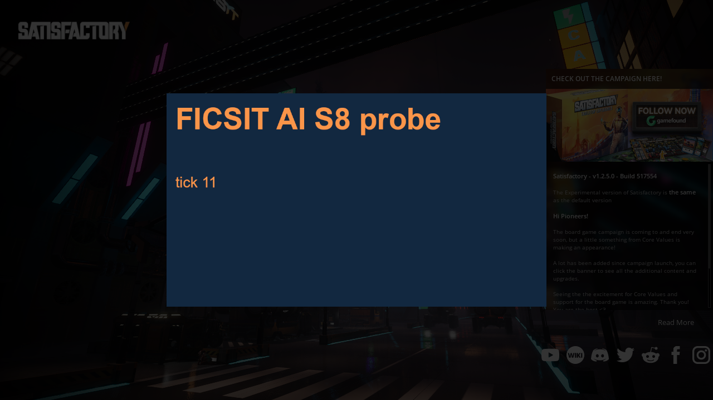
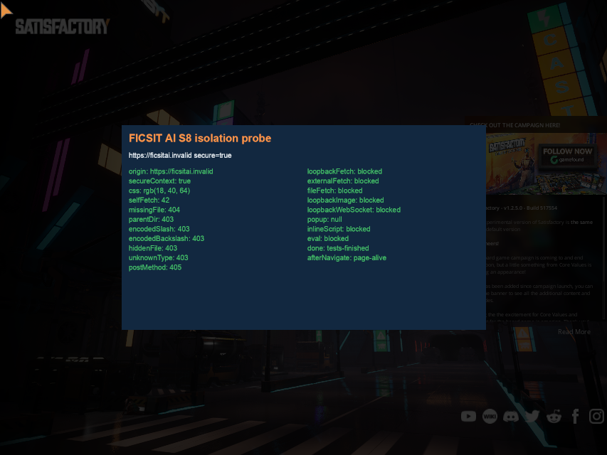
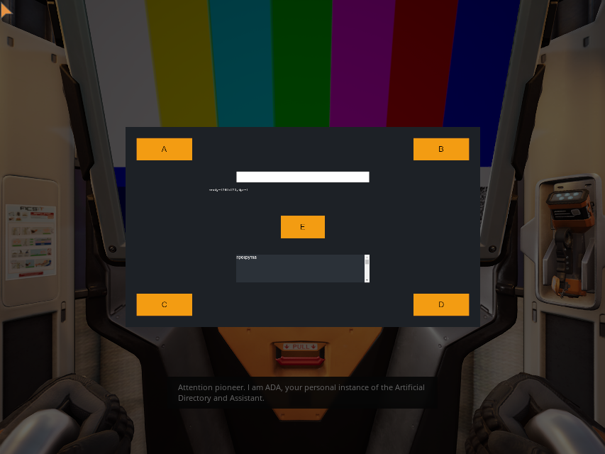
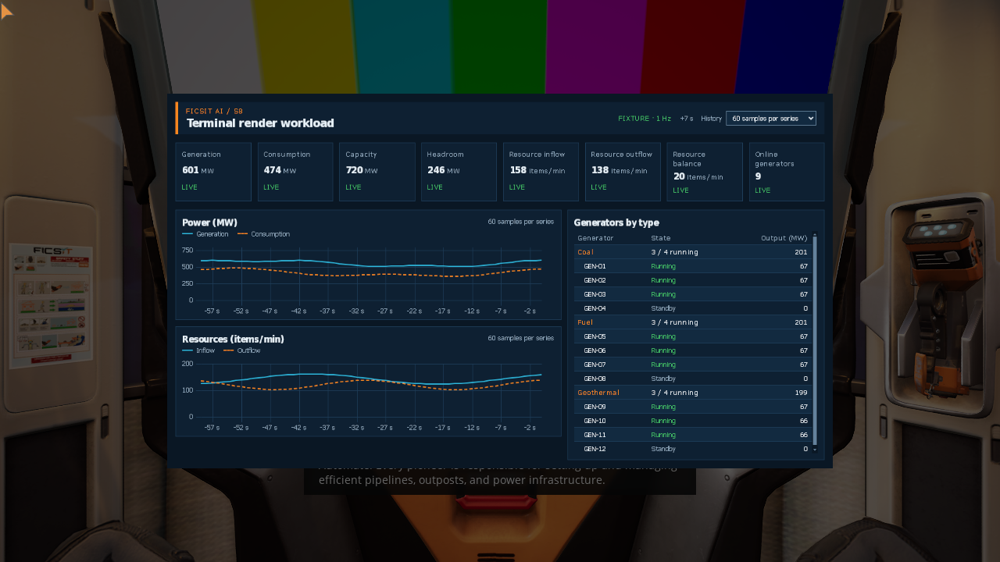
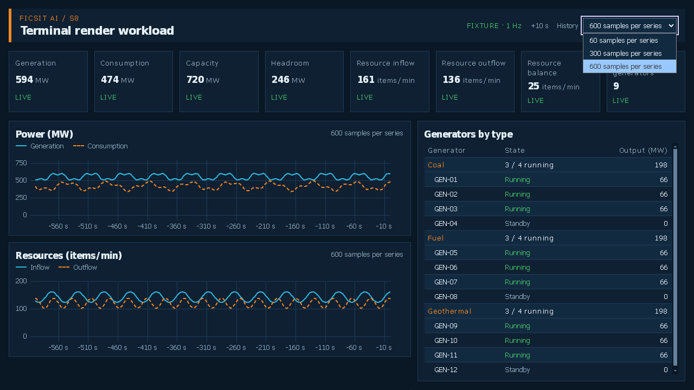
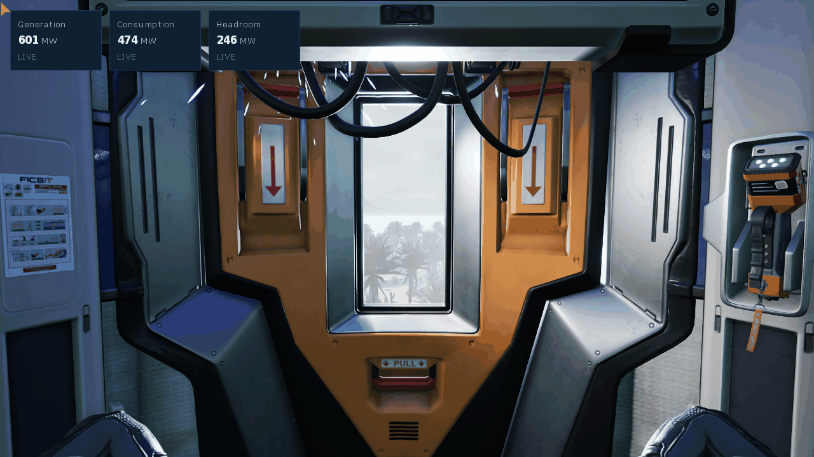

# Статус

| Поле | Значение |
|---|---|
| Что это | Подготовка к [S8](https://github.com/kkkingqz/ficsit-ai-helper/issues/8), которую можно сделать до окружения. Не реализация |
| Зачем сейчас | S8 стартует первым днём недели 2 и упирается только в P-1. Чтобы в день 1 собирать, а не читать репозиторий BLUI |
| Чек-лист | [tests/test-plan/s8-checklist.md](../../tests/test-plan/s8-checklist.md) (Gf2). Нумерация пунктов ниже — его |
| Решается | ADR-032 на воротах W, конец недели 3. До решения базовый план — UMG |
| Ревью | Gs |

# Почему отдельный мод-библиотека

Решение уже в ADR-032, но причину стоит держать перед глазами, потому что она определяет состав: **CEF должен обновляться независимо от основного мода.** Размер поставки ограничением не считается (решение 09.11.2026), 150–200 МБ принимаются. Цель §1.1 «нет обязательных сторонних модов» не нарушается: библиотека наша, и SMM ставит её как зависимость (пункты 1.4–1.6).

Второе следствие: браузер движка недоступен. Проверено — каталогов `Engine\Binaries\ThirdParty\CEF3` и `Engine\Plugins\Runtime\WebBrowserWidget` в установке нет, а собрать модуль WebBrowser внутри мода не даёт лицензия Epic. Поэтому BLUI, а не движковый браузер.

# Состав (пункты 1.2–1.5)

```
mod/FicsitAIWebRuntime/
  FicsitAIWebRuntime.uplugin        модули BluLoader, Blu (Runtime, PreDefault, только Win64), SML ^3.12.0
  Source/BluLoader/, Source/Blu/    исходники BLUI v5.1.0 с нашими правками (FindPlugin, умолчания)
    Blu/Blu.Build.cs                RuntimeDependencies: весь каталог ThirdParty/cef/Win/shipping
  ThirdParty/cef/Win/shipping/      бинарники CEF из релиза BLUI, не из репозитория
  ThirdParty/cef/Win/lib, include   blucef.lib, libcef_dll_wrapper.lib, заголовки — только для сборки
third_party/blui/                   вендоринг форка getnamo v5.1.0 + LICENSE + CHANGES.md
```

Схема уточнена по первой сборке 10.11.2026: модули — родные `BluLoader` и `Blu`, а не свой `FicsitAIWebRuntime`; схемы `local://` нет (см. «Разведка BLUI»), страницы раздаются с `https://ficsitai.invalid/` нашим обработчиком ресурсов.

**Что в `RuntimeDependencies`** (пункт 1.3; фактический перечень — в «Результатах»): `blucef.dll` и его зависимости, `*.pak` и `locales/` из ресурсов CEF, `icudtl.dat`, `snapshot_blob.bin`, `v8_context_snapshot.bin`, вспомогательный процесс CEF. Проверять перечень надо не по документации BLUI, а по тому, что реально отказывается стартовать в готовой игре: это главный источник сюрпризов при упаковке.

**Переименованный CEF — гигиена, а не условие** (исправлено 10.11.2026). С версии 5.1.0 у BLUI свой `blucef.dll`, который не конфликтует с CEF движка в том же процессе. Раньше здесь было написано, что без этого пункт 1.7 нерешаем, — это неверно для Satisfactory: CEF движка и модуля WebBrowser в игре нет, конфликтовать не с чем. Версию 5.1.0 берём по другим причинам — см. «Разведка BLUI по исходникам».

**Зависимость** (1.5): основной `FicsitAI` объявляет `FicsitAIWebRuntime` в списке `Plugins` своего `.uplugin` (в SML 3.x это и есть манифест мода). Проверка 1.6 — установка через SMM на чистом профиле, а не копированием каталога руками: менеджер должен сам подтянуть библиотеку.

# Изоляция (пункты 2.1–2.4)

Три рубежа, и ни один не заменяет другие:

1. **Источник `https://ficsitai.invalid/`** — страницы грузятся только из каталога мода, через обработчик ресурсов (`CefResourceRequestHandler::GetResourceHandler`) в процессе браузера. Раньше здесь была «схема `local://`, которая в BLUI есть и требует доработки» — это неверно (исправлено 10.11.2026): своей схемы в BLUI нет, его `blui://` превращается в `file:///`. Собственную схему CEF требует регистрировать и во вспомогательном процессе, а он в BLUI готовый бинарник; несуществующий источник на `https` этого не требует, даёт странице защищённый контекст и нормально работающий CSP. Домен `.invalid` зарезервирован и никуда не разрешается, поэтому промах обработчика даёт ошибку, а не запрос в сеть. `file://` и `blui://` не используются вовсе: они открывают странице чтение любых файлов.
2. **`OnBeforeBrowse`** (наш `CefRequestHandler`: в BLUI его нет, `BrowserClient` расширяется в `third_party/blui/` с записью в `CHANGES.md`) — любой переход по `http`, `https`, `ftp` и прочему блокируется безусловно. Не «фильтруется по списку», а запрещается целиком: белый список здесь — один наш источник.
3. **`OnBeforeResourceLoad`** — внешние скрипты, стили, шрифты и изображения не загружаются. Страница автономна полностью.

4. **`Content-Security-Policy` заголовком ответа** (уточнено 11.11.2026 по проверке в игре). Политику ставит обработчик ресурсов на каждую HTML-страницу, страница может её только ужесточить. Это не «ловушка на собственную ошибку», как считалось раньше, а полноценный рубеж: `connect-src 'self'` закрывает WebSocket, который мимо `OnBeforeResourceLoad` проходит.
5. **`host-resolver-rules=MAP * ~NOTFOUND`** — последний рубеж в сетевом стеке CEF: не разрешается ни одно имя и ни один адрес, включая `127.0.0.1`. Результаты проверки всех пяти — в разделе «Изоляция: проверка в игре».

**Автономность без сайдкара** (2.4, FR-10) — следствие, а не отдельная работа: статика лежит в моде, данные идут через привязку JavaScript к `FicsitAIApi`, а не по HTTP. Поэтому при остановленном сайдкаре страница открывается мгновенно и показывает «не подключено» из `GetStatus`, без сетевых таймаутов.

# Мост (пункты 4.1–4.4)

Один канал, один конверт, никакого разбора текста:

- **JS → UE:** `blu_event` с конвертом `{ id, op, args }`, где `op` — имя запроса API v0 (`getStatus`, `listMetrics`, `queryMetric`, `querySeries`, `listScopes`), `id` — корреляция ответа.
- **UE → JS:** `ExecuteJavaScript` с вызовом колбэка промиса по тому же `id`.
- **Формы** — замороженные из [public-api-v0.md](public-api-v0.md): дискриминатор `kind` для значения против ряда, enum строками в lowerCamelCase, ошибка `{ code, message, details? }`. Пункт 4.3 требует именно соответствия контракту, и это удобно: мост проверяется на тех же формах, на которых потом работает фасад Co2.
- **В S8 за API стоит заглушка** — спайк проверяет транспорт и задержку, а не данные.

Замер задержки круга (4.4) делаю на пустом конверте и на конверте с рядом в 720 точек: интересна не средняя, а то, как растёт с размером ответа, потому что `querySeries` на окне 60 минут — самый тяжёлый ответ в v0.

# Бюджет процессов

CEF поднимает свои процессы, рендер в BLUI программный. Правило из §6.3.1, условие 4: **живой браузер только у открытого интерактивного экрана и у ближайших терминалов**, остальные показывают кэш рендера (§10.1). Для замеров S8 это означает три открытых экрана 1280×720 с обновлением раз в секунду — так записано в протоколе Gf2.

# Порядок работ

| День | Что | Пункты |
|---|---|---|
| ~~Неделя 2, день 1~~ **сделано 10.11.2026** | Модули `WebSockets` и `HTTP` в готовой игре — по поставке; загрузка из мода — вместе с первой сборкой плагина | 1.1 |
| Неделя 2, дни 1–2 — **сборка и перечень сделаны 10.11.2026**, вендоринг в репозиторий остаётся | Вендоринг BLUI, сборка плагина под Win64 через wine, перечень `RuntimeDependencies` | 1.2, 1.3 |
| Неделя 2, дни 3–4 — **загрузка библиотеки под Proton проверена 11.11.2026**, остальное остаётся | Манифест, зависимость, установка через SMM, бесконфликтная загрузка | 1.4–1.7 |
| ~~Неделя 2, день 5~~ **сделано 11.11.2026** | Локальная схема и три рубежа изоляции | 2.1–2.3 |
| Неделя 3, дни 1–2 — **ввод и фокус, перерисовка по изменению, прозрачная поверхность и размер по пикселям проверены 12.11.2026**, открытие по E остаётся | Открытие по E, фокус ввода и его освобождение, перерисовка по изменению, HUD | 3.1–3.3, 3.5, 3.6 |
| Неделя 3, дни 2–3 | Мост с Co2, замеры задержки круга | 4.1–4.4 |
| Неделя 3, день 4 | Замеры кадрового времени с Gf2 под Proton, отчёт для ворот W | блок 5 |

# Что нужно от других

- **Gf** — окружение (P-1) к концу недели 1, иначе день 1 недели 2 сдвигается целиком. И меш терминала с материалом под render target для пункта 3.4.
- **Gs2** — тестовая страница с библиотекой графиков к середине недели 2. На пустой странице замеры кадрового времени ничего не покажут.
- **Co2** — мост на неделе 3 и заглушка фасада, чтобы формы конверта совпали с его будущим фасадом.
- **Gf2** — протокол замеров и прогон под Proton. Proton у нас основная платформа (ADR-033), и отрицательный результат там не равен отказу от ADR-032: сначала прогон у пилотного тестера на Windows.

# Результаты

## Пункт 1.1: сетевые модули в готовой игре

**Проверено 10.11.2026** по установке Satisfactory 1.2 из Steam (библиотека Flatpak Steam), файлы сборки датированы 28.10.2026 по `Manifest_NonUFSFiles_Win64.txt`. Игра модульная: модули движка лежат отдельными библиотеками `Engine/Binaries/Win64/FactoryGameSteam-<Модуль>-Win64-Shipping.dll`, поэтому наличие модуля проверяется по файлу, а не догадкой.

| Модуль | В поставке | Что видно |
|---|---|---|
| `HTTP` | **есть** | Два бэкенда в одной библиотеке: WinHttp (`FWinHttpSession`, `FWinHttpConnectionHttp` экспортированы) и libcurl 8.12.1 с потоком событий. Экспортирован `IHttpRequest::SetResponseBodyReceiveStreamDelegateV2` — тело ответа можно читать по мере прихода |
| `WebSockets` | **нет** | Ни библиотеки модуля, ни строки `FWebSocketsModule` ни в одной библиотеке игры; в `Engine/Binaries/ThirdParty` нет libwebsockets (там DbgHelp, MsQuic, NVIDIA, Ogg, Steamworks, Vorbis, Windows). Строки про websocket внутри `HTTP` — внутренности libcurl, через API движка они не доступны |
| `Sockets`, `Networking`, `SSL` | есть | Запасной путь, если `HTTP` не подойдёт совсем |
| `HTTPServer` | есть | Не используется: входящего слушателя в игровом процессе нет (§3.3 архитектуры) |

**Следствие для S2** (записано в §3.3 архитектуры, MODULES E1, план): канал строится на модуле `HTTP` игры. Основной вариант — поток: адаптер → мод одним долгим `GET` с построчным JSON в теле, мод → адаптер отдельными `POST`. Запасной — long-poll на том же модуле. Вендоринг IXWebSocket — только если `HTTP` не выполняет `http://` на петле ни одним бэкендом. Собрать движковый `WebSockets` в моде нельзя: исходники движка в репозиторий под GPL не кладутся — та же причина, что у WebBrowser выше.

**Что этой проверкой не закрыто:**

1. **Обычный `http://` на петле.** В библиотеке есть ветка с отказом: `Attempted to create an insecure WinHttp Request which is disabled on this platform`. На Windows такие запросы обычно разрешены, ограничение относится к консолям, но это первое, что проверяет S2: запрос к `http://127.0.0.1` из мода. Если WinHttp откажет — бэкенд libcurl уже в поставке; как его выбрать, по библиотеке не видно, конфиг лежит в pak.
2. **Загрузка из мода.** Пункт 1.1 чек-листа требует, чтобы модуль подключался и инициализировался из мода под SML. По файлам это доказано только для отсутствия `WebSockets` — модуль, которого нет, не загрузится. Для `HTTP` проверка делается первой сборкой плагина: зависимость в `Build.cs` и один запрос при старте.
3. **Сборка Epic Games Store.** Установлена только сборка Steam. Набор модулей движка у EGS ожидается тем же, но не проверен — записать в чек-лист пилотного тестера, если у него EGS.

## Разведка BLUI по исходникам

**Проверено 10.11.2026** по репозиторию [getnamo/BLUI-Unreal](https://github.com/getnamo/BLUI-Unreal) (MIT, релиз v5.1.0 от 25.09.2026) и по движку на машине разработки. Архив релиза не скачивался — это следующий шаг, см. в конце раздела.

**1. Релиза под нашу версию движка нет.** Движок игры — UE 5.6.1 (`~/UnrealEngineCSS/Engine/Build/Build.version`, ветка `5.6.1-CSS`). Релизы BLUI: v4.10.0 — UE 5.5, v5.0.0 — UE 5.7, v5.1.0 — UE 5.8. Но код между ними почти не меняется: от v4.10.0 до v5.1.0 — около сотни строк, в основном переход на API CEF 128. Единственная правка под движок — `RHIUpdateTexture2D` → `CommandList.UpdateTexture2D` в v5.1.0, и в UE 5.6.1 метод есть с той же сигнатурой (`RHICommandList.h:932`). **Ожидание: исходники v5.1.0 собираются под 5.6.1 без правок.** Подтверждает только сборка.

**2. Своей схемы и перехвата запросов нет.** Ни `CefSchemeHandlerFactory`, ни `CefRequestHandler`, ни `OnBeforeBrowse`/`OnBeforeResourceLoad` в исходниках нет. `blui://` в `UBluEye::LoadURL` — это префикс, который заменяется на `file:///` с путём к контенту. Отсюда новая форма первого рубежа изоляции (раздел «Изоляция») и оценка задачи: 0,5 → 1 ч·д, потому что это не доработка, а свой обработчик ресурсов и свой `CefRequestHandler`.

**3. Почему всё равно v5.1.0, хотя переименование CEF нам не обязательно:**

- **Сбой `CefInitialize` больше не роняет процесс** — пишется в лог, браузеры не создаются. Под Proton это разница между «экран недоступен» и упавшей игрой у игрока. До 5.1.0 падение было в `UBluEye::Init`.
- **Загрузчик больше не оставляет каталог CEF в пути поиска DLL.** Раньше любая загрузка библиотеки по голому имени во всём процессе (`d3dcompiler_47`, `dxcompiler`, `vulkan-1` — пример из самих исправлений BLUI) сначала искалась в нашем каталоге. В процессе с десятком модов это чужие сбои, которые выглядят как наши.
- Переименование защищает и от мода, который однажды принесёт свой `libcef.dll`.

**4. Что уже есть и подходит:** ветка программного рендера (`disable-gpu`, `disable-gpu-compositing` в `BluManager` — но не по умолчанию, см. следующий раздел), рендер без окна, `ExecuteJavaScript` для моста UE → JS и `blu_event` для JS → UE. Вспомогательный процесс `BluBrowserProcess.exe` и V8-обработчик `blu_event` в нём — готовые бинарники релиза; мы их не пересобираем, поэтому всё наше — в процессе браузера.

**5. Новый риск — готовые статические библиотеки.** Релиз несёт `blucef.lib` и `libcef_dll_wrapper.lib`. Обёртка — статическая библиотека, собранная автором BLUI его инструментами для UE 5.8, то есть, вероятно, более новым MSVC, чем наш 17.8 (ADR-033). Компоновщик MSVC обязан быть не старше компилятора, собравшего любой объект в сборке; иначе — ошибка компоновки. Проверка — первое, что делается с архивом: версия компилятора в заголовках объектов обёртки. **Если новее — обёртка пересобирается из исходников CEF 128.4.12 нашим MSVC под wine** (CMake, порядка 0,5–1 ч·д из резерва S8). `blucef.lib` — библиотека импорта, к версии компилятора не чувствительна.

**Следующий шаг — архив релиза:** `BLUI-v5.1.0-UE5.8.7z`, 110 МБ, из релизов [getnamo/BLUI-Unreal](https://github.com/getnamo/BLUI-Unreal/releases/tag/v5.1.0). Он нужен для пунктов 1.2–1.3 и проверки п. 5; в репозиторий бинарники не попадают.

## Умолчания BLUI, которые мы меняем

Найдено в `Blu.cpp` и `BluManager.cpp` релиза 10.11.2026, после скачивания архива. Каждое из этого BLUI делает **по умолчанию**, и каждое противоречит архитектуре. Правила записаны в §12 п. 11; правки — вендоринг, каждая строкой в `third_party/blui/CHANGES.md`.

| Умолчание BLUI | Чем плохо для нас | Что делаем |
|---|---|---|
| `remote_debugging_port = 7777` | Входящий слушатель в процессе игры (§12 п. 1). Любой локальный процесс подключает DevTools и выполняет JavaScript на странице, у которой мост к API мода | `0` — выключен. В сборке для разработки — только за флагом диагностики |
| `CPURenderSettings = false` → ветка GPU: `enable-gpu-rasterization`, `enable-webgl`, **`disable-web-security`** | Политика источников выключена: страница читает что угодно откуда угодно, изоляция §6.3.1 держится только на нашем фильтре запросов. GPU под Proton — то, чего §6.3.1 условие 5 просит избегать | Программная ветка: `disable-gpu`, `disable-gpu-compositing`, `enable-begin-frame-scheduling`. `disable-web-security` не включается ни в какой ветке |
| `enable-media-stream` | Доступ к микрофону и камере без запроса разрешения | Убрать |
| `autoplay-policy=no-user-gesture-required` | Медиа на наших страницах нет; лишнее поведение | Убрать |
| `cache_path = <ProjectDir>/BluCache` | В готовой игре это каталог установки: на Windows — Program Files, запись без прав администратора не проходит | Кэш в памяти: `cache_path` пуст, `root_cache_path` — в `Saved` пользователя. В каталог игры ничего не пишется |
| `OnBeforeDownload` пишет в `<плагин>/Downloads/` | Страница может положить файл в каталог мода | Загрузки запрещены (`CanDownload` → `false`) |
| `no_sandbox = true` | Процессы рендера CEF без песочницы | **Оставляем — принятый риск**: песочницу нельзя включить из мода, она требует связывания `cef_sandbox` с исполняемым файлом игры. Компенсация — страницы только наши, сеть закрыта целиком |

Плюс одна правка, без которой мод не работает вовсе: имя плагина `"BLUI"` зашито в трёх `FindPlugin` (`Blu.cpp`, `BluLoader.cpp`, `RenderHandler.cpp`). У нас плагин называется `FicsitAIWebRuntime` — плагин с именем `BLUI` столкнулся бы с любым другим модом, который принесёт BLUI.

## Пункты 1.2–1.3: сборка и поставка

Проверено 10.11.2026 на копии проекта SML, а не в общем `~/Projects/SatisfactoryModLoader`: так сборка спайка не задевает чужие модули.

**1.2 — собирается.** Исходники BLUI v5.1.0 (релиз под UE 5.8) компилируются на 5.6.1-CSS нашим MSVC 14.38 под wine без правок совместимости, и компоновка с готовой `libcef_dll_wrapper.lib` проходит: обёртка собрана тем же набором 14.38 без LTCG, поэтому пересобирать её не нужно (п. 5 разведки снят). Выход — `Blu` 504 КБ и `BluLoader` 44 КБ, отдельно для Steam и EGS. Упаковка UAT `PackagePlugin` — `UAT_EXIT=0`, сборка уже с правками умолчаний.

**1.3 — что в поставке.** Архив `FicsitAIWebRuntime-Windows.zip`: 86 файлов, 186 МБ сжатого, 492 МБ на диске.

| Часть | Сжато | На диске | Что делаем |
|---|---|---|---|
| CEF без локалей: `blucef.dll` (211 МБ), `dxcompiler.dll`, `icudtl.dat`, `resources.pak`, `libGLESv2.dll`, `libEGL.dll`, `vk_swiftshader.dll`, `d3dcompiler_47.dll`, `dxil.dll`, `vulkan-1.dll`, `blucef_elf.dll`, `chrome_*_percent.pak`, `v8_context_snapshot.bin`, `snapshot_blob.bin`, `BluBrowserProcess.exe` | 126 МБ | 275 МБ | Оставляем. Графические библиотеки при программном рендере, возможно, не нужны, но CEF может требовать их и без GPU — убираем только после проверки в игре, не по догадке |
| `locales/`, 55 языков | 11 МБ | 41 МБ | Интерфейс v0.1 английский (§17.1): оставить `en-US.pak` и задать `locale` явно. Минус ≈ 40 МБ на диске |
| PDB четырёх модулей | 41 МБ | 176 МБ | В архив для тестеров не кладём: отладочные символы держим у себя, для разбора дампов. Сейчас их кладёт UAT по умолчанию |
| Модули, `.uplugin`, пустые pak | 0,4 МБ | 1 МБ | — |

**Итог по объёму:** после двух сокращений — около 135 МБ сжатого и ≈ 275 МБ на диске. Почти весь объём — `blucef.dll`, и его не сократить ничем, кроме отказа от CEF. Эту цифру ворота W сравнивают с UMG, у которого её нет.

**Что не попало и правильно:** исходники, `blucef.lib`, обёртка и заголовки — только для сборки, в поставке их нет. Content у плагина пустой, поэтому cook для него тривиален.

**Одна находка про окружение, не про BLUI.** Первая упаковка упала на cook, ещё до BLUI: библиотеки Linux-редактора в копии проекта SML несут RPATH на исходный путь, и модуль `SignificanceISPC` загружался дважды. Лечится пересборкой редактора в копии (≈ 5 мин). Кто копирует проект SML — для второй рабочей копии или для CI, — наступит на то же.

**Не закрыто на 10.11.2026:** загрузка в игре (1.4–1.7), запрос из мода на `http://127.0.0.1` под Proton (вторая половина 1.1) и проверка отказа без падения при сбое `CefInitialize`. Первое — ниже.

## Пункт 1.7: загрузка в готовой игре под Proton

Проверено 11.11.2026 на Steam-копии игры (сборка 517554, Proton Experimental 11.0-100, RTX 3060, D3D12). В `FactoryGame/Mods/` распакованы два архива: SML 3.12.0 нашей сборки и `FicsitAIWebRuntime-Windows.zip`. Игра запущена из песочницы Steam Flatpak напрямую через Proton, без клиента Steam, окно 1280×720, 150 секунд.

**Плагин загружается, игра доходит до главного меню и работает до снятия по таймеру.** Падений, каталога `Crashes` и ошибок компоновки нет. Строки лога по порядку:

```
LogPluginManager: Mounting Mod plugin FicsitAIWebRuntime
LogBluLoader: loaded isolated CEF runtime from Z:/…/Mods/FicsitAIWebRuntime/ThirdParty/cef/Win/shipping/
LogBluLoader: STATUS: BLUI Ready to Load!
LogBlu:  STATUS: Loaded CEF 128.4.12 (chromium 128.0.6613.138)
LogSatisfactoryModLoader: Display: Version check passed successfully! Game Changelist: 517554
LogSatisfactoryModLoader: Display: FicsitAIWebRuntime: 0.1.0
```

Что это доказывает и чего нет:

- **Доказано:** модули `BluLoader` и `Blu` грузятся в фазе `PreDefault` под SML, `blucef.dll` (211 МБ) загружается в процесс игры под wine из каталога мода, правка `FindPlugin` работает в готовой игре, SML видит мод в списке. R-26 в части «BLUI не грузится под SML» под Proton не сработал.
- **`CefInitialize` прошёл** (исправлено в тот же день: сначала здесь было написано обратное). Он вызывается при старте модуля `Blu`, и строка `Loaded CEF` пишется только после его успеха. Браузер в этом прогоне не создавался — см. следующий раздел.
- **1.7 закрыт наполовину:** пункт требует оба мода вместе. Основной `FicsitAI` с зависимостью (1.5) появится после слияния каркаса Gf ([#40](https://github.com/kkkingqz/ficsit-ai-helper/pull/40)).
- **1.4 по формулировке чек-листа неисполним:** в SML 3.x манифест мода — `.uplugin`, отдельного `data.json` нет. Манифест есть и SML его принимает. Формулировку попрошу Gf2 поправить.
- **1.6 (установка через SMM)** требует загрузки обоих модов на ficsit.app хотя бы скрытыми. Это решение King, не раньше ворот W.

**Запуск без клиента Steam работает.** Игра пишет `Failed to initialize backend Platform` и остаётся в офлайне; для проверок мода этого достаточно. Скрипт — `~/Projects/ficsitai-deps/run-game-s8.sh`, вызывается через `flatpak run --command=bash com.valvesoftware.Steam`; лог игры лежит в префиксе Proton, `…/compatdata/526870/pfx/drive_c/users/steamuser/AppData/Local/FactoryGame/Saved/Logs/`.

**Копия игры общая для команды.** До этого прогона в ней не было ни SML, ни каталога `Mods`. Теперь там `Mods/SML` и `Mods/FicsitAIWebRuntime`; убрать — удалить каталог `Mods`.

## Первая страница в игре и запрос на петлю

Проверено 11.11.2026 тем же способом, с третьим модом-пробой `FicsitAIS8Probe` (зависит от SML и `FicsitAIWebRuntime`; лежит в копии проекта SML, в репозиторий не входит и из игры после прогона удалён). Проба в главном меню создаёт один `UBluEye` 1024×576, загружает страницу из `data:`-адреса, выводит текстуру на экран через Slate и шлёт один запрос модулем `HTTP` игры.



| Что | Результат |
|---|---|
| Создание браузера (`CreateBrowserSync`) | 170 мс на GameThread, один раз |
| Первая загрузка страницы | 2,4 с от создания до события страницы; дальше страница живёт |
| Отрисовка | текстура BGRA выводится на экран, цвета верные; снимок сделан игрой |
| Страница → мод (`blu_event`) | событие `ready` дошло, размеры окна страницы 1024×576 |
| Мод → страница (`ExecuteJS`) | два вызова, оба вернули ответ событием за 1–5 кадров |
| Таймеры страницы | `setInterval` 500 мс: 11 тиков за 5,6 с и 35 за 17,6 с — не замедляются |
| Заголовок и `console.log` | доходят до мода через `LogEventEmitter` |
| Запрос на `http://127.0.0.1:18765` модулем `HTTP` (libcurl 8.12.1) | `200`, тело получено, 247 мс на первый запрос |
| Зависимость мода от `FicsitAIWebRuntime` | SML загрузил оба в нужном порядке; модуль пробы линкуется с `Blu` |

**Что закрыто.** Вторая половина 1.1: исходящий запрос из мода на петлю под Proton работает, канал S2 на модуле `HTTP` игры не заблокирован. 1.7 по существу: два наших мода и SML грузятся вместе без конфликтов (вместо основного `FicsitAI` была проба; повторить с ним после #40). Главный риск ворот W — «страницы в игре под Proton нет» — снят.

**Три находки, которые надо разобрать до ворот W:**

1. **Сетевой процесс CEF один раз упал при создании браузера** и был перезапущен: `Network service crashed, restarting service` в `cef.log`. Страница после этого загрузилась, но 2,4 с первой загрузки, вероятно, отсюда. Нужно понять, воспроизводится ли это на Windows у пилотного тестера или это особенность wine.
2. **Профиль CEF пишется на диск**, хотя `cache_path` пуст: в `Saved/FicsitAI/Cef/` появились `Default/` (2,5 МБ), кэши шейдеров и служебные каталоги Chromium, всего 3,8 МБ. Правка умолчаний «профиль в памяти» работает не полностью; в каталог игры при этом ничего не пишется, как и задумано. Среди каталогов есть `Safe Browsing`, `OptimizationHints`, `CertificateRevocation` — это компоненты Chromium, которые умеют обновляться по сети. Исходящих соединений я в этом прогоне не замерял; это пункт для рубежа изоляции 2.x.
3. **170 мс на GameThread при создании браузера** — заметный рывок. Создавать браузер надо один раз и заранее (при загрузке мира), а не при открытии экрана.

## Разбор находок: сеть, процессы, профиль

Шесть прогонов 11.11.2026 той же пробой, с журналом сетевых событий CEF (`--log-net-log`) и списком процессов. Ключи CEF на время спайка можно задавать переменной окружения `FICSITAI_CEF_SWITCHES` без пересборки; эта лазейка убирается до вендоринга.

**CEF сам ходит в интернет — исправлено.** Без единой внешней ссылки на странице CEF за 130 секунд обратился к `accounts.google.com` (`ListAccounts`) и `optimizationguide-pa.googleapis.com` (`GetModels`) и искал прокси по WPAD. Это нарушает §12: наружу из процесса игры не идёт ничего, кроме петли. В умолчания плагина добавлены ключи:

| Ключи | Что убирают |
|---|---|
| `no-proxy-server` | поиск прокси по WPAD |
| `disable-background-networking`, `disable-component-update`, `disable-sync`, `disable-domain-reliability`, `disable-client-side-phishing-detection`, `no-pings`, `no-first-run`, `no-default-browser-check`, `disable-default-apps` | фоновые службы Chromium |
| `disable-features=OptimizationHints,OptimizationGuideModelDownloading,…` | загрузку моделей оптимизации |
| `host-resolver-rules=MAP * ~NOTFOUND , EXCLUDE localhost` | **рубеж:** ни одно внешнее имя не разрешается |

После этого в журнале сети остаются только попытки `ListAccounts`, которые упираются в `~NOTFOUND` и не открывают соединения, и проверка доступности IPv6 (UDP-сокет на адрес публичного DNS без отправки данных). Мост и запрос мода на петлю работают как раньше: канал мода идёт через модуль `HTTP` игры, а не через CEF. **Остаток:** сами попытки `ListAccounts` не выключены; адрес по IP рубеж имён не закрывает — это задача фильтра запросов (2.x).

**Сетевой процесс CEF завершается при создании первого браузера — причина не найдена.** Воспроизводится в шести прогонах из шести. В журнале исключений Proton (`WINEDEBUG=+seh`) нет ни нарушения доступа, ни другого сбоя: процесс уходит без исключения, CEF пишет `Network service crashed, restarting service` и поднимает новый за 1,5–2,3 с. Ключ `enable-features=NetworkServiceInProcess` CEF игнорирует. Следствие одно — первая страница появляется через 2,4–2,9 с после создания браузера. Что остаётся проверить: повторяется ли это при создании второго браузера и на Windows у пилотного тестера.

**Процессы: пять на одну страницу.** Графический (он есть и при программном рендере), два отрисовщика (один запасной), сетевой и хранилище. Сетевой и графический живут с запуска игры, остальные — с создания браузера. Потребление памяти под wine по `ps` не оцениваю: в каждый процесс отображён `blucef.dll` на 211 МБ, и числа завышены. Замер памяти — в блоке 5, на Windows.

**Профиль на диске остаётся.** 3,7 МБ в `Saved/FicsitAI/Cef/` при любом наборе ключей, `incognito` не действует. Там кэш, история и посещённые ссылки — только наших страниц. Убрать можно только в коде BLUI, создав браузер с собственным контекстом запросов в памяти; это правка для вендоринга.

**Создание браузера:** 122–170 мс на GameThread в шести прогонах.

**Падение на выходе, если игра закрылась до загрузки CEF.** Если другой мод не загрузился и игра выходит на этапе загрузки плагинов, деструктор объекта по умолчанию `UBluEye` обращается к незагруженной `blucef.dll`, и выход превращается в отчёт о падении с нашей библиотекой наверху стека (`0xc06d007e`). Виноват не наш мод, но выглядит так. Правится проверкой в деструкторе; в очередь на вендоринг.

**Общая копия игры — на одного.** Пока шли прогоны, в общую копию положили другой мод, и игра перестала запускаться у всех. Для своих прогонов я сделал отдельную копию жёсткими ссылками (места не занимает) и отдельный префикс Proton: `~/.var/app/com.valvesoftware.Steam/Projects/ficsitai-co/{game,compat}`. Скрипт — `~/Projects/ficsitai-deps/run-probe.sh`.

## Изоляция: проверка в игре (пункты 2.1–2.4)

Проверено 11.11.2026 под Proton на CL 517554. В `BrowserClient` добавлены обработчики запросов, переходов и загрузки; раздача идёт из одного каталога (`FicsitAIWeb::SetWebRoot`, пока — `Web/` самого плагина). Тестовая страница `Web/s8probe/` выполняет 20 проверок и сообщает каждую в мод; рядом работает локальный сервер на `127.0.0.1:18765`, который пишет любой дошедший запрос.



| Что проверено | Результат |
|---|---|
| Страница грузится с `https://ficsitai.invalid/`, контекст защищённый, свои стили, скрипт и `fetch` своего файла работают | да |
| Выход из каталога страниц: `/../`, `..%2f`, `..%5c`, скрытые файлы, неизвестный тип файла | 403; отсутствующий файл — 404, `POST` — 405 |
| `fetch` на `127.0.0.1`, на внешний хост, на `file://`; картинка с `127.0.0.1`; WebSocket на `127.0.0.1` | заблокировано |
| Всплывающее окно; встроенный скрипт; `eval` | окно не создаётся; скрипт и `eval` не выполняются |
| Страница уводит себя на `http://127.0.0.1…` | переход отменён, страница жива |
| Мод вызывает `LoadURL` с `http://127.0.0.1…` и с `file:///C:/windows/win.ini` | оба отменены, адрес браузера не изменился |
| Что увидел локальный сервер за прогон | только собственный запрос мода через модуль `HTTP` игры |
| Что в журнале сети CEF | ни одного соединения: попытки `ListAccounts` упираются в запрет имён, остальное — проверка доступности IPv6 без отправки данных |

**Рубежи проверены по отдельности.** Второй прогон шёл со снятым заголовком политики (временный ключ `FICSITAI_S8_NO_CSP`): `fetch`, картинку и `file://` остановил фильтр запросов, переходы — `OnBeforeBrowse`. WebSocket на `127.0.0.1` фильтр запросов не видит вовсе — запрос дошёл до сетевого стека и был остановлен только запретом имён (`ERR_NAME_NOT_RESOLVED`). Встроенный скрипт и `eval` без политики выполняются: от них защищает только она. Вывод: ни один рубеж убирать нельзя, и `MAP * ~NOTFOUND` обязан оставаться без исключений — прежнее `EXCLUDE localhost` убрано.

**Чек-лист.** 2.1, 2.2 и 2.3 выполнены. 2.4 выполнен в части «статика без сети»: страница открывается при выключенном сайдкаре, сетевых ожиданий нет. Состояние «не подключено» на экране — дело моста и фасада (блок 4).

**Первая загрузка терялась — добавлен сторож.** Переход на нашу страницу, запрошенный сразу после создания браузера, пропадал без ошибки: браузер оставался на `about:blank` в состоянии «загружается». Это следствие завершения сетевого процесса CEF при создании первого браузера (раздел выше); с `data:`-адресом это выглядело как задержка 2,4 с, с настоящим запросом — как зависание навсегда. В `BrowserClient` добавлен сторож: если переход на наш источник не начал загружаться за 3 с, он повторяется, не больше трёх раз. В двух прогонах из двух сработал один повтор, страница загрузилась. Цена — первая страница появляется через три с лишним секунды после создания браузера; это ещё один довод создавать браузер заранее, при загрузке мира.

**Попутные правки BLUI:**

- `OnBeforePopup` возвращал `false` — всплывающие окна были разрешены. Теперь запрещены.
- Поля `bIsClosing` и `BrowserId` в `BrowserClient` не были инициализированы.

**Что ещё всплыло:**

- **Зависание игры на раннем старте** — один раз из семнадцати запусков, до загрузки наших модов (журнал обрывается на строке 275, до инициализации RHI). Причина неизвестна; протокол проверки такой прогон отклоняет как «главное меню — нет».
- **Рабочие потоки страниц** (`worker-src 'none'`) запрещены политикой: их запросы идут мимо обработчиков браузера. Понадобятся — нужен обработчик на уровне контекста запросов.
- **Две временные лазейки** в плагине — переменные окружения `FICSITAI_CEF_SWITCHES` и `FICSITAI_S8_NO_CSP` — убираются до вендоринга.

**Не закрыто:** причина завершения сетевого процесса, профиль в памяти, проверка в деструкторе `UBluEye`, каталог страниц основного мода вместо каталога плагина, ввод и фокус (блок 3), прозрачная поверхность и открытие по клавише (3.6), замеры кадрового времени (блок 5), отказ без падения при сбое `CefInitialize`, прогон с основным модом `FicsitAI`, вендоринг.

## Ввод и фокус: проверка в игре (пункты 3.1–3.3)

Проверено 12.11.2026 под Proton на CL 517554, в мире (сохранение `main_continue`). Код — в плагине, вне репозитория до вендоринга.

**Что сделано.** В плагин добавлен Slate-виджет `SFicsitAIWebView`. Он рисует текстуру браузера на всю свою геометрию и переводит мышь и клавиатуру в события CEF. Координаты пересчитываются из локальной геометрии виджета в пиксели страницы, поэтому виджет можно растягивать, а масштаб интерфейса не сбивает попадание. Курсор страницы (рука над кнопкой, текстовый курсор над полем) берётся из `OnCursorChange` CEF. Сам экран виджет не открывает и не закрывает — этим занимается владелец. Для спайка владелец — проба:

- **открытие** по F8 через препроцессор ввода Slate. Он видит клавиши раньше игры. Шаги: `FlushPressedKeys`, режим `UIOnly` с фокусом на виджете, курсор показан;
- **закрытие** по F8 или Escape. Шаги: в странице отпускается всё нажатое, режим `GameOnly`, курсор скрыт, снова `FlushPressedKeys`, фокус возвращается во вьюпорт игры. Отпускание поглощённой клавиши в игру тоже не уходит, иначе Escape открыл бы меню паузы.

**Как проверено.** Ввод синтезируется через `FSlateApplication`. Это тот же путь, что у настоящей мыши и клавиатуры после оконной системы: препроцессоры, проверка попадания, фокус, виджеты, вьюпорт игры. Экран нарочно не 1:1: 1000 × 562 единиц Slate на странице 1280 × 720. Тестовая страница `Web/s8input/` сообщает в мод, что получила. Сохранение оказалось вступлением, где персонаж ещё сидит в капсуле и ходить не может. Поэтому «игра получает клавишу» и «клавиша залипла» проверяются по состоянию клавиш самой игры (`IsInputKeyDown`), а не по движению.



| Что проверено | Результат |
|---|---|
| F8 открывает экран; фокус клавиатуры у виджета; курсор виден; страница получает фокус и при повторном открытии | да |
| Щелчки по пяти целям (углы и центр) | все пять — точно в центр цели, до пикселя |
| Двойной щелчок | `dblclick` в той же точке |
| Щелчок в поле и набор `Ab1 Жё`, затем Backspace | `Ab1 Ж`: латиница, цифра, пробел, кириллица, удаление |
| `event.key` и `event.code` | `Backspace / Backspace`, `ArrowLeft / ArrowLeft`, `w / KeyW` |
| Колесо над прокручиваемой областью | прокрутка на 100 px за щелчок |
| Пока экран открыт, игра клавиш не получает | W уходит в страницу, игра её не видит |
| Escape закрывает: курсор скрыт, фокус у вьюпорта игры, страница теряет фокус | да |
| После закрытия игра снова получает W | да |
| Залипание: W нажата в игре, экран открыт, W отпущена при открытом экране, экран закрыт | в игре W не нажата |

Итог последнего прогона — 25 проверок из 25. Четыре прогона до него нашли две ошибки синтеза в самой пробе и неверный формат скан-кода (о нём ниже).

**Чего проверка не покрывает.**

- **Настоящий ввод от оконной системы через Proton.** Синтез начинается после Windows-сообщений; путь X11 → Wine → `WM_KEYDOWN` → Slate не проверен. Нужна ручная проверка — [инструкция](s8-manual-check.md), 24 пункта, 20–30 минут, на Windows или Linux.
- **Ввод через IME** — китайский, японский. Буфер обмена, контекстное меню, перетаскивание.
- **Открытие по E у объекта терминала (3.1)** — меша терминала ещё нет, это пункт 3.4 Gf. Открытие по клавише вызывает тот же код, так что E добавится как ещё один вызов `Open`.

**Дефекты ввода BLUI.** Его собственные функции ввода не используются, виджет шлёт события CEF сам:

- модификаторы проверялись через `else if`, и Ctrl+Shift терялся;
- движение мыши шло без флагов нажатых кнопок, и выделение перетаскиванием не работало;
- число щелчков всегда было 1, двойного щелчка не было;
- колесо давало 10 единиц сразу по обеим осям;
- скан-код не передавался, `event.code` был пустым;
- `RawCharKeyPress` текла памятью через `new`.

**Две находки под Proton:**

- CEF 128 ждёт в `native_key_code` голый скан-код, а не поле `lParam` сообщения `WM_KEYDOWN`, как в старых примерах CEF. Проверено в игре на обоих вариантах: с `lParam` `event.code` пустой.
- `MapVirtualKeyW` под Wine не ставит префикс расширенной клавиши, и стрелка влево приходила как `Numpad4`. Виджет помечает расширенные клавиши сам: стрелки, Home, End, PageUp, PageDown, Insert, Delete, правые Ctrl и Alt, Win.

**Размер браузера должен следовать пикселям экрана.** Единицы Slate умножаются на масштаб интерфейса: 0,67 при 720p, 0,5 при окне 853 × 640. Экран размером «1280 единиц» занимает 853 пикселя, и страница 1280 × 720 пересэмплируется. Попаданию это не мешает — проверки прошли при обоих масштабах. Но картинка мягче, а при другом соотношении сторон страница растягивается. Хост должен менять размер браузера (`ResizeBrowser`) по пиксельному размеру виджета. В пятом прогоне окно игры открылось 853 × 640, хотя в командной строке те же `-ResX=1280 -ResY=720`; причину не искал.

**Клавиша закрытия не может идти через Enhanced Input.** Горячие клавиши мода по §6.7 — действия Enhanced Input игры. Но пока экран в режиме `UIOnly`, Enhanced Input клавиш не получает. Закрывать экран должен препроцессор Slate или сам виджет, а открывать можно действием Enhanced Input.

**Первая загрузка** и здесь прошла через сторож: потеря, повтор через 3 с, страница готова через 3,2–3,5 с после создания браузера. Создавать браузер заранее по-прежнему нужно.

## Страница нагрузки из PR #37 в игре

Страница Gs2 ([PR #37](https://github.com/kkkingqz/ficsit-ai-helper/pull/37), ревизия `4104d93`) лежит в плагине как `Web/spikes/s8/` и открывается по адресу `https://ficsitai.invalid/spikes/s8/load.html`. Её взяли из готовой сборки Gs2 той же ревизии; файлы страницы побайтно совпадают с PR, uPlot 1.6.32 — из той же сборки, без скачивания.



Графики, плитки и таблица рисуются, данные обновляются раз в секунду, режим `?points=600` работает. Ошибок в консоли страницы нет. Снимок сделан во втором прогоне, до растяжения экрана на весь вьюпорт, поэтому страница уменьшена масштабом интерфейса. Щелчок по выпадающему списку `History` ронял игру; теперь список раскрывается и работает — раздел «Выпадающие списки» ниже. Таблица прокручивается колесом на несколько пикселей: её содержимое почти помещается в панель.

Для замеров блока 5 страница готова. Прозрачный вариант и размер браузера по пикселям сделаны — раздел «Перерисовка, размер и прозрачный HUD» ниже.

**Не закрыто по блоку 3:** открытие по E (после 3.4), ручная проверка настоящего ввода.

## Выпадающие списки: падение игры и исправление

**Как CEF рисует страницу без окна.** В режиме рендера в текстуру (OSR) у браузера нет своего окна. Страницу CEF отдаёт через `OnPaint` готовым кадром во весь размер — тип `PET_VIEW`. Раскрытый `<select>` в Chromium — не часть страницы, а отдельный маленький виджет. В обычном браузере это отдельное окно поверх страницы. Без окна CEF отдаёт его третьим путём:

1. `OnPopupShow(true)` — слой появился;
2. `OnPopupSize(rect)` — где он лежит на странице;
3. `OnPaint` с типом `PET_POPUP` — его собственный кадр, размером со слой (у списка History — 173 × 74);
4. `OnPopupShow(false)` — слой закрыт.

Совместить слой со страницей должен клиент: так делает эталонный клиент CEF (`cefclient`).

**Что делал BLUI.** `RenderHandler::OnPaint` тип кадра не смотрел, а `OnPopupShow` и `OnPopupSize` не реализовывал. Кадр слоя уходил в `UBluEye::TextureUpdate` как кадр страницы. Тот копирует `1280 × 720 × 4` байт, 3,7 МБ, из буфера размером 50 КБ — чтение далеко за концом буфера. Дальше всё зависит от того, что лежит в памяти следом: мусор в углу текстуры или падение.

**Проверено 12.11.2026 в игре.** Щелчок по списку History на странице нагрузки из #37 — `EXCEPTION_ACCESS_VIOLATION`, игра закрылась. Стек: `RenderHandler::OnPaint` → `UBluEye::TextureUpdate` → копирование памяти. До этого исправления **любая страница с `<select>` роняла игру по щелчку**.

То же чтение за буфером грозило при смене размера браузера: CEF присылает кадр нового размера раньше, чем BLUI пересоздаёт текстуру. Это прямо касается следующего шага — размера браузера по пикселям экрана.

**Исправление в плагине:**

- кадр страницы не того размера, что текстура, пропускается с предупреждением в журнале;
- плагин держит копию последнего кадра страницы. В обычном режиме копируются только изменённые области, кадр CEF уходит в текстуру напрямую — лишнего полного копирования на кадр нет;
- пока слой открыт, он накладывается поверх копии в своём прямоугольнике; за край страницы не выходит;
- при закрытии слоя его место восстанавливается из копии.

Мышь и клавиатуру в раскрытый список CEF направляет сам, по координатам — виджету ввода ничего добавлять не пришлось.

**Проверено в игре.** Щелчок раскрывает список под полем (снимок ниже). Выбор мышью «60 samples» перестроил графики. Enter закрывает список, место под ним восстанавливается. Падений нет, проверки ввода — 25 из 25.



**Что остаётся:**

- **Тем же путём в Chromium, по его устройству, идут** подсказки `<datalist>`, автозаполнение полей, выбор даты, времени и цвета (`<input type=date|time|color>`). Не проверял; исправление общее, но проверку надо сделать до того, как эти элементы появятся на экранах.
- **Список у нижнего края страницы.** BLUI не сообщает CEF размеры экрана (`GetScreenInfo`), и Chromium может разместить список так, что часть уйдёт за край страницы и обрежется. Не проверял.
- **Вид системный.** Раскрытый список рисует Chromium, CSS страницы на него почти не действует. Где нужен список в стиле экранов, нужен свой компонент дизайн-системы. Запрет на `<select>` после этого исправления не нужен.
- **Ручная проверка на Windows** — пункты 8 и 20 [инструкции](s8-manual-check.md).

## Перерисовка, размер и прозрачный HUD (пункты 3.5, 3.6)

Проверено 12.11.2026 под Proton на CL 517554, в мире (`main_continue`), окно 1280 × 720. Код — в плагине и пробе, вне репозитория до вендоринга. Сценарий пробы — 40 проверок из 40, из них 15 новых. Прозрачная страница — сборка Gs2 из [PR #47](https://github.com/kkkingqz/ficsit-ai-helper/pull/47) на `065eccd`, `load.html?overlay=1`.



### Прозрачная поверхность и быстрый вызов (3.6)

**Что сделано:**

- **Фон браузера.** У браузера без окна фон с нулевой альфой включает прозрачную отрисовку. BLUI фон не задавал: CEF читает 0 как «не задано» и берёт общий фон, а он у браузера без окна тоже прозрачный. По правилам CEF поэтому и раньше всякая страница без своего фона в CSS была прозрачной; в игре этого не проверял. Теперь фон задаётся явно: прозрачный экран — альфа 0, обычный экран — белый.
- **Смешивание.** Кадр CEF приходит с premultiplied alpha: так его смешивает эталонный клиент CEF. Виджет рисует его с `ESlateDrawEffect::PreMultipliedAlpha`. У непрозрачной страницы альфа везде 255, и картинка та же, что раньше.
- **HUD в пробе** — отдельный прозрачный браузер во весь вьюпорт. Он лежит ниже экрана (Z 900 против 1000), видимость `HitTestInvisible`, фокус ему никто не даёт. Ввод в игру пропускает хост, а не CSS страницы: правило `pointer-events: none` в игре ни на что не влияет.

| Что проверено | Результат |
|---|---|
| Кадр HUD прозрачен там, где страница ничего не рисует | 95,5 % выборки с альфой 0; на снимке под плитками виден мир |
| Браузер HUD — в пиксельный размер вьюпорта | 1280 × 720 |
| HUD показан: фокус у вьюпорта игры, курсор скрыт, игра получает W | да |
| Щелчок по центру экрана поверх HUD остаётся в игре | да, фокус у `SViewport` |
| Быстрый вызов: F8 открывает экран поверх HUD | 0,34 мс от клавиши до открытия, фокус у страницы; HUD остаётся |
| Пока экран открыт, игра не получает W; после закрытия получает, HUD на месте | да |

Быстрый вызов мгновенный, потому что браузер экрана создан заранее. Открытие только меняет видимость и режим ввода; первая загрузка страницы при этом не нужна, она занимает 3,2–3,7 с.

### Перерисовка по изменению (3.5)

CEF без окна присылает кадр только тогда, когда страница изменилась, а BLUI обновлял текстуру только из этих кадров. Холостых обновлений на каждом графическом кадре нет и не было. Перерисовка по таймеру игры не нужна.

Лишним было другое: на любой кадр CEF BLUI копировал **весь** кадр — 3,7 МБ при 1280 × 720, даже если изменилась одна цифра. Теперь:

- копируются только изменённые области, плотно, без запаса;
- буферы загрузки переиспользуются.

Буферы оказались главным. Свежий буфер в 3 МБ на каждый кадр под Wine стоит страничных ошибок: первый прогон дал 3,1 мс GameThread на кадр страницы нагрузки, с переиспользованием — 0,71 мс.

| Страница, 10 с | Кадров CEF | Доля кадра в загрузке | Скопировано | GameThread |
|---|---|---|---|---|
| Статичная (`s8input`) | 0 | — | 0 | 0 |
| Нагрузка, данные раз в секунду | 1,0/с | 86,5 % | 3,1 МБ/с | 0,71 мс на кадр, 0,71 мс/с |
| HUD (`?overlay=1`), в фоне | 1,0/с | 0,8 % | 28 КБ/с | 0,01 мс на кадр |

Страница нагрузки перерисовывает почти весь кадр каждую секунду: графики uPlot перерисовываются целиком. Значит, цена экрана — это цена его страницы. HUD с тремя плитками почти ничего не стоит. Остаток 0,71 мс — две копии кадра на GameThread: в текстуру и в копию страницы, нужную для раскрытого `<select>`. Вторую можно делать только при открытом списке; пока не трогал. Цену загрузки на рендер-потоке не мерил — это замеры Gf2 (блок 5).

### Размер браузера по пикселям экрана

Виджет следит за своим пиксельным размером, то есть абсолютным размером геометрии. В нём уже учтены масштаб интерфейса, DPI и `SScaleBox`. Когда размер не меняется 0,15 с, виджет меняет размер браузера. Желаемый размер виджета от размера страницы больше не зависит, иначе виджет и браузер раздували бы друг друга.

**Дефекты BLUI при смене размера:**

- прежняя текстура оставалась в корне сборщика мусора навсегда: утечка 3,7 МБ видеопамяти на каждую смену;
- до первого кадра нового размера показывалась пустая текстура;
- материал меша оставался на старой текстуре — это касается 3.4.

Теперь до первого кадра нового размера показывается прежняя текстура, затем она уходит в сборщик. Материал переключается на новую. Кадр старого размера, пришедший после смены, пропускается, как и раньше.

| Что проверено | Результат |
|---|---|
| Страница нагрузки во весь вьюпорт (1922 × 1081 единиц Slate) | браузер 1280 × 720 — пиксель в пиксель, без пересэмплирования |
| Экран вдвое меньше | браузер 640 × 360; один кадр старого размера пропущен; прежняя текстура освобождена |
| Снова во весь экран | браузер 1280 × 720, прежняя текстура освобождена |

Страница Gs2 при 640 × 360 перестраивается в две колонки плиток — адаптивная вёрстка работает и в игре.

### Что не проверено

- **Настоящий ввод через Proton поверх HUD.** Курсор и щелчки синтезированы, как в 3.2. Пункты для ручной проверки — в [инструкции](s8-manual-check.md).
- **Смена размера при раскрытом `<select>`.**
- **Кайма на краях полупрозрачных элементов.** Текстура в sRGB, а смешивание premultiplied. На снимке каймы не видно, но глазами на светлом фоне игры не проверял.
- **Цена на рендер-потоке и кадровое время** — блок 5, Gf2.

### Для замеров конфигурации D (Gf2)

Архивы плагина и пробы с этим кодом — `~/Projects/ficsitai-deps/handoff/s8-block3-20261112/`. Без `-FicsitAIS8Auto` проба ничего не делает сама:

- **F7** — показать или скрыть HUD;
- **F8** — экран поверх HUD;
- **F9** — сменить страницу экрана;
- **`-FicsitAIS8Hud`** — HUD сразу при входе в мир.

Экран в ручном режиме тоже следует за пикселями.

# Чем это не жалко

Если S8 провалится и ворота W выберут UMG, из этой работы не теряется ничего, кроме самого плагина: граница API та же, формы конверта те же, бюджет процессов неприменим, а изоляция и вендоринг — отдельная ветка. Поэтому вперёд идёт пункт 1.1, который нужен S2 независимо от исхода.
